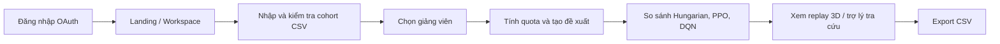
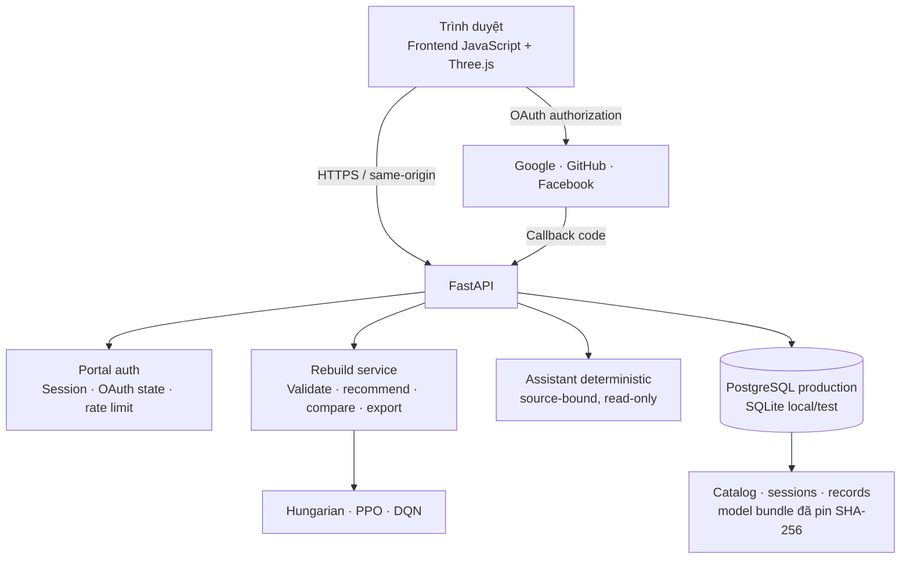

# UniMatch

Pipeline nguồn mới và RL hai cấp: [hướng dẫn chạy, kết quả và dữ liệu còn thiếu](docs/nested_rl_rebuild_20261028.md).

**Ủy quyền hiện hành — 28/10/2026 (ưu tiên cao nhất):** triển khai RL trong kỳ kết hợp kế thừa checkpoint qua kỳ theo [đặc tả hiện hành](docs/rl_hai_cap_va_corpus_giang_vien_20261027.md). Thu thập/trích xuất lại nguồn vào `data_rebuild/nested_rl_20261028/<run>/`, không ghi đè raw/gold/checkpoint cũ; CSV URL chỉ là seed. Hạn chế URL-only ngày 27/10 đã được thay thế. Học kỳ học vụ lấy ngày có bằng chứng trên trang 1–2: tháng 9–12 năm Y → Y.1, tháng 1–5 → (Y−1).2, tháng 6–8 → (Y−1).3. Phiên bản training riêng: V1/2024.1 gồm lịch sử đến 12/2024; V2/2024.2 là 01–05/2025; V3/2025.1 là 06–12/2025, gồm hè học vụ 2024.3; V4/2025.2 là 01–05/2026. Hè 2025.3 và kỳ 2026.1 chưa ánh xạ phiên bản training; không tự tạo V5. Ngày thiếu/mâu thuẫn giữ unresolved, không suy từ ngày hiện tại. Cutoff snapshot faculty/model đã chốt vẫn giữ 30/06/2025 và 30/06/2026, khác cửa sổ sự kiện sinh viên; tháng 6/2025 thuộc V3, không thuộc V2 sinh viên. Availability được quản lý riêng; vòng thiếu tín hiệu thật phải skipped, không tạo feedback giả.

> Nền tảng web hỗ trợ lập hồ sơ sinh viên, khám phá giảng viên hướng dẫn từ nguồn đã duyệt và so sánh các đề xuất phân công khóa luận có ràng buộc quota.

UniMatch được xây dựng cho bối cảnh đồ án/khóa luận đại học. Hệ thống kết hợp xử lý dữ liệu có kiểm chứng, tối ưu phân công có ràng buộc, các mô hình học tăng cường và giao diện trực quan để hỗ trợ điều phối viên cùng sinh viên xem xét phương án ghép nối phù hợp.

> **Lưu ý quan trọng:** UniMatch là công cụ hỗ trợ ra quyết định. Điểm tương thích không phải đánh giá năng lực học thuật, không phải cam kết hướng dẫn, và không thay thế quyết định của điều phối viên. Các checkpoint nghiên cứu được hiển thị với trạng thái nghiên cứu; không được diễn giải là đã được xác nhận cho phân công thực tế.

---

## Mục lục

- [Bài toán](#bài-toán)
- [Khả năng chính](#khả-năng-chính)
- [Luồng trải nghiệm](#luồng-trải-nghiệm)
- [Kiến trúc](#kiến-trúc)
- [Thuật toán và dữ liệu](#thuật-toán-và-dữ-liệu)
- [Bảo mật và quyền riêng tư](#bảo-mật-và-quyền-riêng-tư)
- [Cấu trúc repository](#cấu-trúc-repository)
- [Công nghệ sử dụng](#công-nghệ-sử-dụng)
- [Triển khai và vận hành](#triển-khai-và-vận-hành)
- [Giới hạn đã biết](#giới-hạn-đã-biết)
- [Kiểm thử và chất lượng](#kiểm-thử-và-chất-lượng)

---

## Bài toán

Phân công sinh viên cho giảng viên hướng dẫn không chỉ là bài toán xếp hạng theo độ giống chủ đề. Hệ thống cần xem xét đồng thời:

- Chủ đề khóa luận của sinh viên và dữ liệu chuyên môn đã được phê duyệt của giảng viên.
- Danh sách giảng viên khả dụng và số lượng sinh viên cần phân công.
- Quota chia đều có ràng buộc.
- Khả năng truy vết nguồn dữ liệu, phiên bản encoder và checkpoint.
- Quyền riêng tư: dữ liệu cohort/kết quả của một người dùng không được lộ sang người dùng khác.

UniMatch chuyển bài toán trên thành luồng có kiểm soát: nhập dữ liệu → kiểm tra hợp đồng CSV → chọn giảng viên → tạo/so sánh đề xuất → xem lại kết quả → xuất CSV.

## Khả năng chính

### Xác thực và quản lý phiên

- Đăng ký/đăng nhập xã hội qua **Google**, **GitHub** và **Facebook**.
- OAuth state dùng một lần, có thời hạn 5 phút và được ràng buộc với cookie callback của trình duyệt.
- PKCE (`S256`) cho Google và GitHub.
- Cookie phiên `HttpOnly`, `SameSite=Lax`, `Secure` trên HTTPS; thời hạn phiên 8 giờ.
- Endpoint khởi tạo OAuth được giới hạn tần suất theo IP kết nối trực tiếp, mặc định 10 yêu cầu trong 60 giây.
- Không gửi hoặc lưu provider access token ở browser/database ứng dụng.

### Hỗ trợ phân công khóa luận

- Kiểm tra CSV sinh viên và giảng viên theo hợp đồng dữ liệu xác định.
- Cung cấp CSV template cho các thực thể hỗ trợ.
- Tính quota phân chia đều cho tập giảng viên được chọn.
- Tạo đề xuất phân công dựa trên:
  - Hungarian baseline.
  - PPO có action masking.
  - DQN có action masking.
- So sánh kết quả giữa các thuật toán.
- Phát lại trực quan luồng phân công bằng mô hình 3D.
- Xuất kết quả phân công ra CSV, có phòng vệ CSV formula injection.

### Dữ liệu giảng viên và trợ lý tra cứu

- Catalog giảng viên dựa trên dữ liệu/nguồn đã được phê duyệt.
- Pipeline có taxonomy, feature allowlist/exclusion và kiểm tra chất lượng chứng cứ.
- Trợ lý tra cứu deterministic, chỉ đọc, không dùng LLM và không gọi mạng trong lúc trả lời.
- Câu trả lời gắn với nguồn hồ sơ công khai đã được duyệt; không suy diễn thông tin thiếu chứng cứ.
- Giới hạn và từ chối truy vấn có dấu hiệu yêu cầu bí mật, thông tin liên hệ, dữ liệu sinh viên khác hoặc prompt injection.

### Dashboard và giao diện

- Giao diện tiếng Việt, ưu tiên desktop và mobile.
- Landing page mô phỏng campus bằng Three.js, dùng hình học native thay vì tải mô hình/ảnh raster bên ngoài.
- Tôn trọng `prefers-reduced-motion`, tự dừng cảnh khi tab/đối tượng không còn hiển thị và hỗ trợ người dùng bật/tắt chuyển động.
- Dashboard đọc snapshot báo cáo huấn luyện đã lưu, hiển thị curve, khoảng tin cậy, checkpoint được chọn và tiêu chí plateau.
- Phần tử thao tác chính có kích thước tối thiểu phù hợp cho touch; bố cục đáp ứng trên màn hình hẹp.

## Luồng trải nghiệm



Đăng ký và đăng nhập dùng cùng danh tính OAuth: lần đăng nhập đầu tiên tạo tài khoản, các lần tiếp theo khôi phục đúng tài khoản theo cặp `provider` và `subject`. Hệ thống không tự nối các tài khoản OAuth chỉ vì có cùng email.

## Kiến trúc



### Thành phần backend

| Thành phần | Trách nhiệm |
|---|---|
| `backend/app/portal.py` | OAuth, phiên browser, state/PKCE, rate limit và báo cáo training đã lưu. |
| `backend/app/rebuild_api.py` | API validate, quota, recommendation, compare, export và static frontend. |
| `backend/app/rebuild_assistant_api.py` | API assistant read-only với kiểm tra request chặt chẽ. |
| `backend/app/production.py` | Entry point public; bắt buộc HTTPS, PostgreSQL và model bundle được pin checksum. |
| `backend/app/portal_database.py` | Lớp truy cập SQL dùng chung cho SQLite local/test và PostgreSQL production. |
| `database/portal.sql` | Schema additive trong namespace `unimatch_portal`: user, session, OAuth pending state, record, catalog, advisor và model bundle. |

### Lưu trữ và tính bền vững

- **Production:** PostgreSQL, sử dụng schema `unimatch_portal` tách khỏi các bảng legacy.
- **Local/test:** SQLite.
- Session token chỉ được lưu dưới dạng SHA-256 hash.
- Cohort và run được gắn với `scope_hash`; người dùng không thể đọc đề xuất của người dùng khác.
- Production chỉ khởi động khi model bundle có key/checksum đã pin và dữ liệu bundle khớp SHA-256 kỳ vọng.

## Thuật toán và dữ liệu

### Thuật toán phân công

| Thuật toán | Vai trò trong UniMatch |
|---|---|
| **Hungarian** | Baseline tối ưu có tên, luôn sẵn sàng khi dữ liệu đầu vào hợp lệ. |
| **PPO** | Mô hình RL có action masking, dùng checkpoint native và contract đã kiểm tra. |
| **DQN** | Mô hình RL có action masking, dùng checkpoint native và contract đã kiểm tra. |

Khi tải mô hình phục vụ, hệ thống kiểm tra contract của encoder, feature taxonomy, reward weights, quota policy và checksum file checkpoint. Upload của người dùng không được dùng để fit/train lại encoder hay mô hình trong handler phục vụ.

### Nguyên tắc dữ liệu

- Không tự điền abstract, công bố, trình độ, nguyện vọng, quota hoặc cam kết hướng dẫn khi dữ liệu không chứng minh được.
- Không coi chức danh/tên là feature chuyên môn.
- Không biến dữ liệu thiếu hoặc không chắc chắn thành kết luận tích cực/tiêu cực giả.
- Chỉ hiển thị dữ liệu giảng viên từ snapshot/catalog đã được phê duyệt.
- Dữ liệu nhập cho một cohort là private theo scope người dùng.

## Bảo mật và quyền riêng tư

UniMatch có các kiểm soát bảo mật ở tầng ứng dụng:

- Origin check và chặn `Sec-Fetch-Site: cross-site` cho các thay đổi trạng thái qua browser.
- OAuth callback xác minh state cookie bằng so sánh hằng thời gian (`hmac.compare_digest`).
- OAuth pending state một lần, có TTL; access token của provider không được ghi vào DB.
- Rate limit endpoint khởi tạo OAuth; limiter được dọn entry hết hạn để không tăng bộ nhớ vô hạn.
- Kiểm tra kích thước request/CSV và giới hạn tối đa 500 dòng import.
- Kiểm tra JSON dạng allowlist cho assistant request; giới hạn payload assistant 32 KiB.
- Parameterized SQL qua lớp database dùng chung.
- `Cache-Control: no-store`, `X-Content-Type-Options: nosniff`, `Referrer-Policy: no-referrer`.
- Production bổ sung HSTS, `X-Frame-Options: DENY` và `Permissions-Policy` hạn chế camera/microphone/geolocation.

> Rate limiter OAuth hiện là in-memory theo process. Khi triển khai nhiều instance/worker, cần thay bằng store phân tán như Redis hoặc rate limiting tại reverse proxy/load balancer.

## Cấu trúc repository

```text
.
├── backend/
│   └── app/                  # FastAPI, OAuth, API, storage và production entrypoint
├── configs/
│   └── data/                 # Taxonomy, allowlist/exclusion cho feature
├── database/                 # Schema PostgreSQL/SQLite
├── deployment/               # Cấu hình reverse proxy
├── frontend/                 # HTML/CSS/JavaScript, Three.js và build script
├── scripts/                  # Audit, chuẩn bị dữ liệu, train, evaluate, publish release
├── src/
│   ├── baselines/            # Hungarian/baseline utilities
│   ├── data_pipeline/        # Chuẩn hóa, nguồn, evidence, CSV contracts, review
│   ├── domain/               # Bài toán phân công và quota
│   ├── environment/          # RL environment
│   ├── evaluation/           # Benchmark, ranking, diagnostics và convergence
│   ├── features/             # Feature pipeline và acceptance gates
│   ├── rl/                   # PPO, DQN và continual-learning utilities
│   └── serving/              # Rebuild service, registry và assistant deterministic
├── .github/workflows/        # CI
├── Dockerfile                # Multi-stage production image
├── render.yaml               # Render Blueprint manifest
└── requirements-*.txt        # Dependency contracts theo mục đích
```

Các thư mục dữ liệu runtime, output huấn luyện, backups, tài liệu nội bộ và test suite có thể được giữ local/ngoài Git tùy chính sách `.gitignore` của repository.

## Công nghệ sử dụng

| Lớp | Công nghệ |
|---|---|
| Backend | Python 3.12, FastAPI, Uvicorn, HTTPX, Pydantic |
| Machine learning | PyTorch CPU, Stable-Baselines3, SB3-Contrib, Gymnasium, NumPy, SciPy, scikit-learn |
| Data/storage | PostgreSQL + Psycopg, SQLite |
| Frontend | JavaScript ES Modules, HTML/CSS, Three.js `0.186.1` |
| Build/deploy | Docker multi-stage, Render Blueprint, GitHub Actions |
| OAuth | Google OAuth/OIDC, GitHub OAuth, Facebook Login/Graph API |

## Triển khai và vận hành

Production image xây dựng frontend ở stage Node.js và chạy FastAPI ở stage Python CPU-only. Entry point production từ chối khởi động nếu thiếu các điều kiện an toàn cơ bản:

- Origin public không phải HTTPS.
- Database không phải PostgreSQL.
- Thiếu model bundle key hoặc SHA-256 được pin.
- Bundle không tồn tại hoặc checksum không khớp.

Health endpoint chỉ trả trạng thái sẵn sàng khi truy vấn storage thành công và model đã được nạp. Manifest `render.yaml` khai báo environment variables cho database, origin public, model bundle, OAuth providers và rate limit OAuth.

## Kiểm thử và chất lượng

CI trên GitHub Actions được kích hoạt cho `push` và `pull_request`, gồm:

- PostgreSQL 16 disposable cho contract/integration tests.
- Kiểm tra cú pháp frontend và build frontend.
- Compile Python cho `src`, `backend` và `scripts`.
- Contract tests cho pipeline, service và public API.
- Docker build image production CPU.
- Kiểm tra import các thành phần production trong image Docker.

Các kiểm chứng sử dụng artifact private, full-budget multi-seed hoặc live-provider authentication được tách khỏi public CI; không được thay bằng dữ liệu giả để suy ra chất lượng production.

## Giới hạn đã biết

- Mô hình PPO/DQN là artifact nghiên cứu; trạng thái `production_promoted` không được tự suy ra từ việc hệ thống đã deploy.
- Dashboard là snapshot báo cáo đã lưu, không phải tiến trình huấn luyện thời gian thực.
- Không tự liên kết nhiều OAuth identity theo email để tránh nối nhầm tài khoản.
- Facebook Login có thể yêu cầu app live, privacy policy, data-deletion instructions và review của Meta trước khi dùng cho người dùng bên ngoài danh sách test.
- OAuth thực tế còn phụ thuộc redirect URI, consent screen và cấu hình dashboard của từng provider khớp hoàn toàn với public origin.
- Không nên coi kết quả phân công của mô hình là kết luận về năng lực cá nhân hoặc quyết định chính thức.

---

## Định hướng sử dụng có trách nhiệm

UniMatch hướng đến việc làm rõ dữ liệu, ràng buộc và lý do của một phương án phân công; không tự động hóa quyết định học vụ. Mọi kết quả cần được điều phối viên xem xét cùng với các yếu tố nghiệp vụ, nguyện vọng chính thức và quy định của đơn vị đào tạo.
