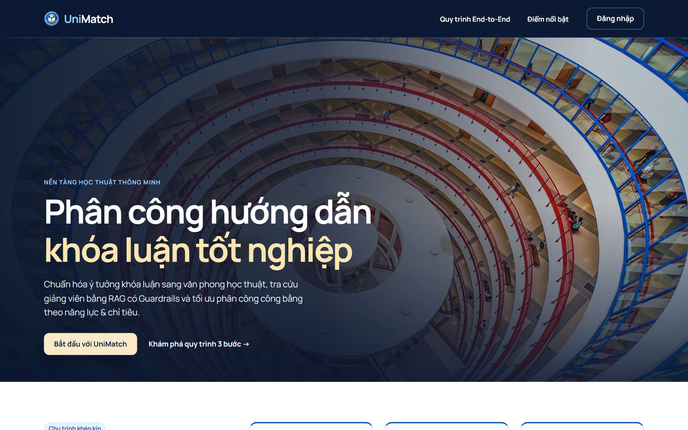
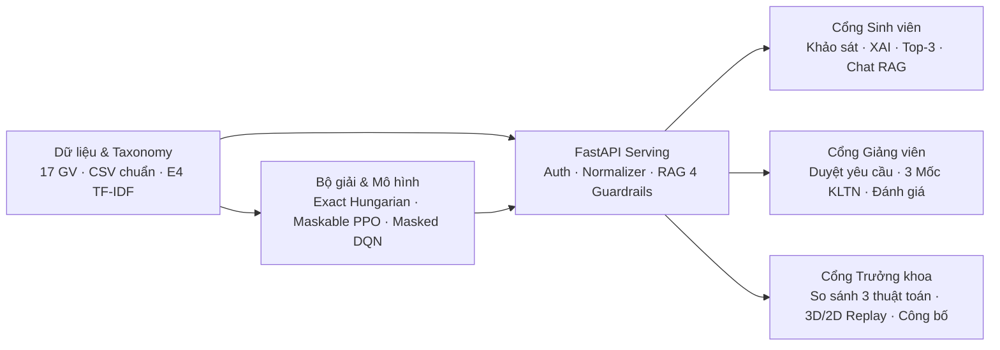
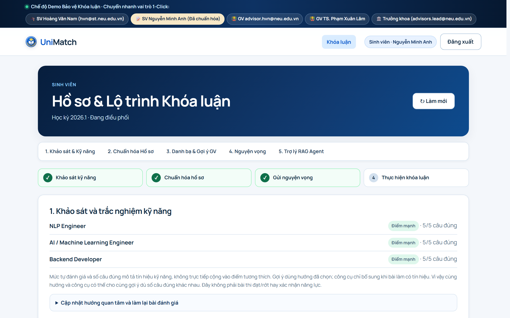
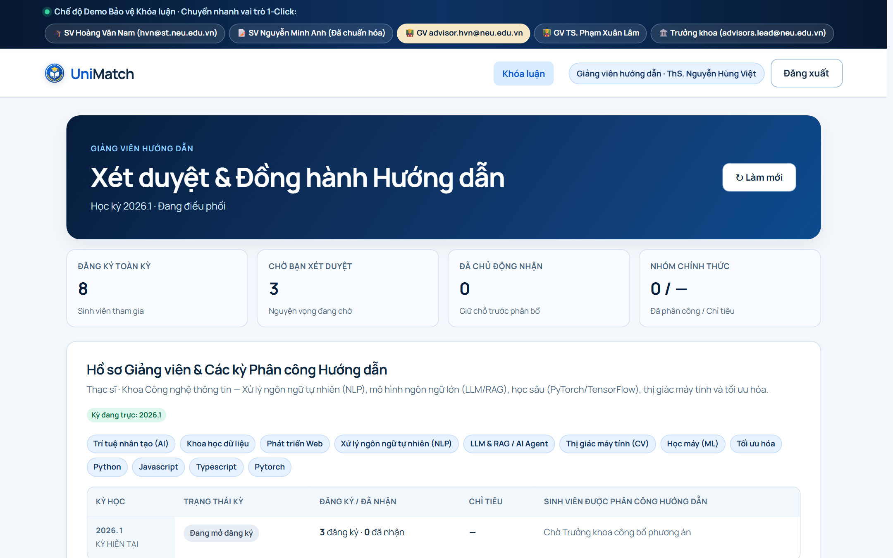
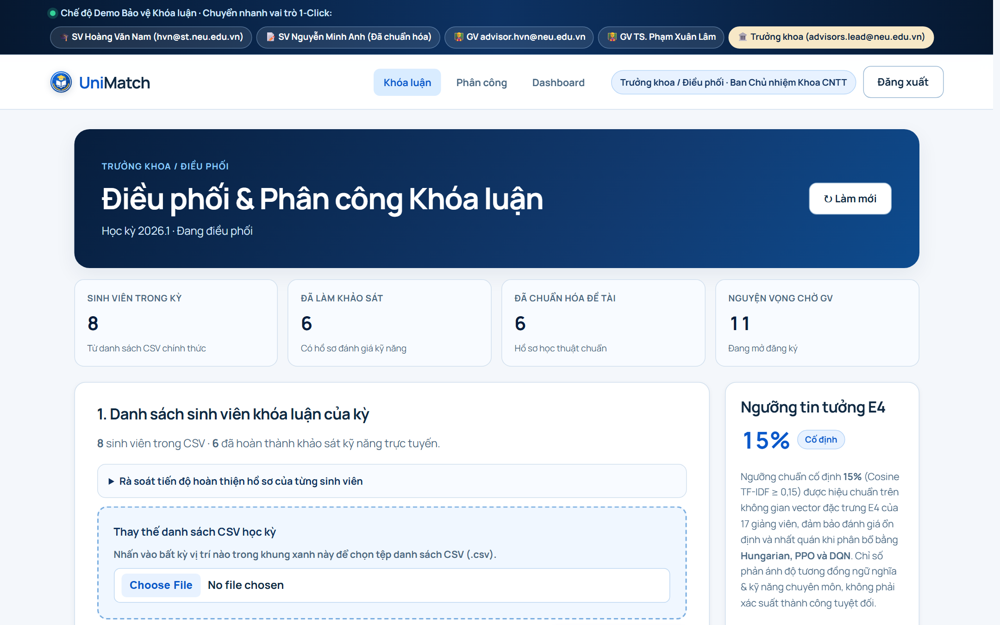

<div align="center">


# UniMatch

** Nền tảng hỗ trợ Khóa luận Tốt nghiệp **

[](pyproject.toml)
[](backend/app/production.py)
[](src/rl/)
[](LICENSE)

</div>

**UniMatch** là hệ thống hỗ trợ phân công sinh viên – giảng viên hướng dẫn và quản trị toàn bộ quy trình Khóa luận Tốt nghiệp (KLTN) cho Khoa Công nghệ Thông tin (FIT-NEU). Hệ thống kết hợp **Chuẩn hóa hồ sơ học thuật lai**, **Trợ lý AI học vụ RAG 4 lớp Guardrails**, và **Tối ưu hóa phân công đa thuật toán** (**Exact Hungarian**, **Maskable PPO**, **Action-Masked Double DQN**) trên ma trận năng lực chuẩn hóa của **17 giảng viên**.

<p align="center">
  
</p>

---

## Hệ thống làm gì?

UniMatch số hóa khép kín quy trình KLTN cho 3 vai trò (**Sinh viên**, **Giảng viên**, **Trưởng khoa / Điều phối viên**) qua 4 tầng xử lý:



### 1. Không gian Sinh viên (`student`)
- **Khảo sát năng lực theo vai trò (`roles-v2`):** Đánh giá định hướng chuyên môn và công cụ thực hành ([`backend/app/thesis_tracks.py`](backend/app/thesis_tracks.py), [`backend/app/thesis_assessment.py`](backend/app/thesis_assessment.py)).
- **Chuẩn hóa giọng văn học thuật (`src/serving/profile_normalizer.py`):** Chuyển ý tưởng đề tài tự do (kể cả văn nói hoặc pha trộn thuật ngữ Việt–Anh) thành **Hồ sơ đề tài học thuật chuẩn** (Tên đề tài, Tóm tắt mục tiêu & phạm vi phương pháp, Nhãn kỹ năng chuẩn Taxonomy), hiển thị đối chiếu *Trước / Sau*.
- **Gợi ý giảng viên kèm giải thích XAI & Top-3 nguyện vọng:** Chấm điểm tương đồng ngữ nghĩa E4 (ngưỡng tin tưởng khóa cố định ở mức **15%**), giải thích các nhóm kỹ năng trùng khớp và gửi tối đa 3 nguyện vọng ưu tiên.
- **Trợ lý AI Học vụ RAG 4 lớp Guardrails (`src/serving/rag_agent.py`):** Truy hồi lai **BM25 + E4 Cosine Embedding + Reciprocal Rank Fusion (RRF)** trên hồ sơ giảng viên và công bố khoa học đã kiểm chứng, đi kèm 4 lớp bảo vệ:
  1. Chống Prompt Injection & rò rỉ thông tin cá nhân chéo (PII).
  2. Chặn yêu cầu gian lận học thuật (viết hộ khóa luận / làm bài tập hộ).
  3. Lọc phạm vi nghiêm ngặt, từ chối câu hỏi ngoài ngữ cảnh KLTN.
  4. Trả lời có trích dẫn nguồn xác thực.

### 2. Không gian Giảng viên (`faculty`)
- **Xét duyệt hướng dẫn theo hạn ngạch:** Xem hồ sơ sinh viên đã chuẩn hóa, điểm tương đồng E4, và chấp nhận hoặc từ chối nguyện vọng theo chỉ tiêu cá nhân.
- **Theo dõi xuyên học kỳ & hậu phân công:** Quản lý sinh viên qua 3 mốc (**Đề cương**, **Giữa kỳ**, **Bản cuối**), ghi nhận xét và chấm kết quả hướng dẫn cuối kỳ.

### 3. Không gian Trưởng khoa / Điều phối viên (`dean`)
- **Quản trị danh sách & ma trận kỹ năng công bằng:** Nhập/xuất CSV danh sách sinh viên và ma trận kỹ năng 8 nhóm năng lực của **17/17 giảng viên** ([`configs/data/advisors_full_skills.csv`](configs/data/advisors_full_skills.csv), [`backend/app/advisor_skills.py`](backend/app/advisor_skills.py)), khắc phục thiên lệch đối với giảng viên có công bố thuần tiếng Việt.
- **Đối sánh trực tiếp 3 thuật toán & phát lại 3D/2D:** Chạy và so sánh **Exact Hungarian**, **Maskable PPO**, **Action-Masked Double DQN** trên cùng tập ràng buộc cứng (giảng viên đã nhận trước, hạn ngạch tùy chỉnh, nguyện vọng sinh viên), kết hợp sân khấu 3D Three.js và replay 2D ([`frontend/campus-scene.js`](frontend/campus-scene.js), [`frontend/allocation-replay.js`](frontend/allocation-replay.js)).
- **Điều chỉnh thủ công, công bố & xuất báo cáo:** Ghi nhận lịch sử thay đổi có giao dịch ([`backend/app/thesis_history.py`](backend/app/thesis_history.py)), công bố kết quả chính thức, xuất `.xlsx` / `.csv` và trích xuất gói phản hồi ẩn danh cho Continual RL.

---

## Giao diện minh họa

<table>
  <tr>
    <td width="50%">
      <strong>Không gian Sinh viên</strong> — Khảo sát kỹ năng, chuẩn hóa hồ sơ học thuật, gợi ý XAI &amp; Trợ lý RAG
      <br /><br />
      
    </td>
    <td width="50%">
      <strong>Không gian Giảng viên</strong> — Hồ sơ chuyên môn, xét duyệt nguyện vọng &amp; theo dõi các kỳ phân công
      <br /><br />
      
    </td>
  </tr>
  <tr>
    <td colspan="2">
      <strong>Không gian Trưởng khoa / Điều phối viên</strong> — Quản lý danh sách CSV, ngưỡng tin tưởng E4 (15%), đối sánh Hungarian / PPO / DQN &amp; công bố kết quả
      <br /><br />
      
    </td>
  </tr>
</table>

---

## Hệ thống làm được ở mức nào?

### 1. Mức độ hoàn thiện kỹ thuật

| Hạng mục | Trạng thái &amp; Mức độ thực tế |
| --- | --- |
| **Cổng web 3 vai trò &amp; bảo mật** | Hoàn thiện End-to-End: Email đăng ký/kích hoạt, OAuth (Google/GitHub/Facebook), phân quyền theo vai trò, bảo vệ CSRF/Same-Origin, rate-limit, SQLite cục bộ &amp; PostgreSQL production ([`backend/app/portal.py`](backend/app/portal.py), [`backend/app/portal_database.py`](backend/app/portal_database.py)). |
| **Chuẩn hóa hồ sơ &amp; RAG Guardrails** | Hoạt động End-to-End: hỗ trợ gọi LLM qua API (OpenRouter/Gemini) và tự động fallback sang bộ xử lý deterministic cục bộ khi chạy offline hoặc không cấu hình API key. |
| **Ma trận năng lực giảng viên** | Đã chuẩn hóa **17/17 giảng viên** FIT-NEU trên 8 nhóm năng lực taxonomy ([`configs/data/taxonomy_v1.yaml`](configs/data/taxonomy_v1.yaml)), hỗ trợ Trưởng khoa cập nhật động qua CSV. |
| **Ràng buộc phân công (Action Masking)** | **0 vi phạm chỉ tiêu (quota)** và **100% sinh viên được phân công** (khi tổng chỉ tiêu đủ) nhờ action masking thời gian thực trong môi trường [`src/environment/rebuild_env.py`](src/environment/rebuild_env.py). |
| **Đóng gói, Docker &amp; CI/CD** | Dockerfile multi-stage CPU (Node 22 + Python 3.12), `docker-compose.yml` kèm PostgreSQL 16, cấu hình Render ([`render.yaml`](render.yaml)), GitHub Actions CI &amp; keepalive. |
| **Kiểm thử tự động** | **600 passed, 4 skipped** (4 test PostgreSQL chỉ chạy khi cấu hình `UNIMATCH_TEST_DATABASE_URL`, chạy đầy đủ trên GitHub Actions CI) + kiểm thử frontend (`test_thesis_frontend.mjs`). |

### 2. Kết quả thực nghiệm RL &amp; đối sánh thuật toán

Dữ liệu nghiên cứu được tách theo thời gian chống rò rỉ dữ liệu tương lai (*Temporal Split Anti-Leakage*):

| Phiên bản | Học kỳ | Train | Validation | Test ngoài |
| --- | --- | ---: | ---: | ---: |
| **V1** | 2024 (lịch sử đến 08/2025) | 87 | 19 | — |
| **V2** | 2025.1 (09–12/2025) | 46 | 16 | — |
| **V3** | 2025.2 (01–05/2026) | 45 | 11 | — |
| **Test ngoài** | 2025.3 (06–08/2026) | — | — | 19 |

- **Gói mô hình phục vụ (`strict-github-20261112-v1`):** Đóng gói **6 checkpoint khóa SHA-256** (`PPO` và `DQN` qua `V1`, `V2`, `V3`) trên không gian trạng thái **420 chiều**, kế thừa liên tiếp 4 vòng mỗi kỳ (`R1 → R4`, `131.072 bước/vòng`, tích lũy **1.572.864 bước** đến `V3`).
- **Kết quả đối chiếu trên tập Final Test đóng băng** (mở 1 lần sau khi chốt lựa chọn mô hình, trích từ báo cáo thực nghiệm RL hai cấp; đơn vị là *objective trung bình trên mỗi sinh viên*):

| Tập Test | Số SV (`n`) | PPO được giữ | DQN được giữ | Exact Hungarian *(cận trên)* | Greedy | Random (`seed=42`) |
| --- | ---: | ---: | ---: | ---: | ---: | ---: |
| **V1** | 4 | `0.105690` | `0.109519` | `0.113652` | `0.081137` | `0.056308` |
| **V2** | 14 | `0.130587` | `0.148416` | `0.191483` | `0.144405` | `0.111890` |
| **V3** | 11 | `0.134744` | `0.137924` | `0.193676` | `0.169539` | `0.122965` |

### 3. Phạm vi &amp; giới hạn hiện tại (Trung thực học thuật)
- Trên bài toán phân công tĩnh toàn đợt (*full-batch offline*), **Exact Hungarian** vẫn là cận trên tối ưu toàn cục; **Maskable PPO / Masked Double DQN** vượt trội **Random**, bám sát hoặc vượt **Greedy** ở V1–V2 với **0 vi phạm chỉ tiêu**, và phục vụ đánh giá chính sách phân công tuần tự / học tiếp nối qua nhiều vòng phản hồi.
- Các checkpoint RL hiện tại được huấn luyện theo cấu hình nghiên cứu (single-seed trên dữ liệu proxy hồi cứu từ văn bản khóa luận và công bố công khai; không sử dụng dữ liệu cá nhân nhạy cảm như GPA).
- Khi chạy không có API key LLM (`UNIMATCH_OPENROUTER_API_KEY` / `GEMINI_API_KEY`), bộ chuẩn hóa học thuật và Trợ lý RAG hoạt động ở chế độ deterministic cục bộ dựa trên từ điển Taxonomy và chỉ mục BM25 + E4.

---

## Khởi chạy nhanh

### Cách 1: Chế độ Demo 1-Click (Khuyến nghị để trải nghiệm cục bộ)

Yêu cầu: Python 3.10+ (đã cài gói trong [`requirements-github-rebuild.txt`](requirements-github-rebuild.txt)) và Node.js 22+.

```bash
# 1. Cài dependencies và build giao diện tĩnh frontend/dist
npm --prefix frontend ci
npm --prefix frontend run build

# 2. Khởi chạy Demo Server tại http://127.0.0.1:8767
python scripts/run_demo.py --reset --open-browser
```

Sau khi chạy, mở `http://127.0.0.1:8767/login.html` hoặc dùng **Thanh chuyển nhanh vai trò Demo** ở đầu trang (`UNIMATCH_DEMO_MODE=1`, tự động tắt khi `UNIMATCH_DEPLOYMENT=production`). Các tài khoản Demo được nạp sẵn (mật khẩu dự phòng: `UniMatch-Demo-2026!`):

| Tài khoản | Vai trò | Trạng thái dữ liệu mẫu |
| --- | --- | --- |
| `sv1@demo.unimatch.edu.vn` | Sinh viên | Đã khảo sát, đã chuẩn hóa đề tài học thuật &amp; gửi nguyện vọng |
| `hvn@st.neu.edu.vn` | Sinh viên | Tài khoản sinh viên NEU trong danh sách kỳ |
| `sv2@demo.unimatch.edu.vn` | Sinh viên | Chưa làm khảo sát — trải nghiệm luồng chuẩn hóa từ đầu |
| `advisor.hvn@neu.edu.vn` | Giảng viên | ThS. Nguyễn Hùng Việt — có danh sách nguyện vọng chờ duyệt |
| `lam.px@demo.unimatch.edu.vn` | Giảng viên | TS. Phạm Xuân Lâm — đã chủ động nhận 1 sinh viên để kiểm thử ràng buộc cứng |
| `advisors.lead@neu.edu.vn` | Trưởng khoa | Ban Chủ nhiệm Khoa — điều phối 8 sinh viên, đối sánh PPO / DQN / Hungarian |

### Cách 2: Chạy bằng Docker Compose (PostgreSQL + FastAPI)

Sao chép [`.env.example`](.env.example) thành `.env`, cấu hình các biến môi trường cần thiết (`POSTGRES_PASSWORD`, `UNIMATCH_MODEL_BUNDLE`, v.v.) rồi chạy:

```bash
docker compose up --build
```

---

## Cấu trúc Repository

| Đường dẫn | Vai trò |
| --- | --- |
| [`frontend/`](frontend/) | Giao diện Vanilla HTML/CSS/ES Modules, Three.js 3D (`campus-scene.js`) &amp; 2D Replay (`allocation-replay.js`) |
| [`backend/`](backend/) | FastAPI API, xác thực OAuth/Email/Demo, chuẩn hóa hồ sơ, quản lý học kỳ &amp; hậu phân công |
| [`src/`](src/) | Pipeline dữ liệu, Taxonomy, đặc trưng E4, chuẩn hóa học thuật, RAG Guardrails, RL (`PPO`/`DQN`) &amp; Serving |
| [`scripts/`](scripts/) | Khởi chạy Demo (`run_demo.py`), local server, huấn luyện &amp; đánh giá RL, đóng gói release |
| [`configs/`](configs/) | Từ điển `taxonomy_v1.yaml`, allowlist/excluded features &amp; dữ liệu CSV chuẩn (`advisors_full_skills.csv`, import schemas) |
| [`database/`](database/) | Lược đồ cơ sở dữ liệu PostgreSQL (`portal.sql`) |
| [`tests/`](tests/) | Bộ kiểm thử tự động Backend, Frontend, Guardrails RAG, Chuẩn hóa hồ sơ &amp; RL (`tests/rebuild/`) |
| [`Run/`](Run/) | Tiện ích kiểm tra sức khỏe dịch vụ Render (`ping_render.py`) |

---

## Kiểm thử chất lượng

```bash
npm --prefix frontend run check && npm --prefix frontend run build
node tests/rebuild/test_thesis_frontend.mjs
python -m compileall -q src backend scripts
python -m pytest tests/rebuild -q
```

---

## Giấy phép

Dự án được phát hành theo giấy phép **MIT** — xem chi tiết trong file [LICENSE](LICENSE).
