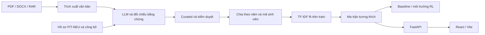

# Kiến trúc hệ thống phân bổ hướng dẫn

Cập nhật 27/09/2026. Tài liệu mô tả mã nguồn và kiểm chứng hiện có; không xem mục tiêu kế hoạch 56 ngày là kết quả đã đạt.

## Luồng xử lý

`data/1.pdfs` giữ nguyên nguồn. `data/extracted` chứa văn bản, cache LLM và bằng chứng; `data/cache/fit` giữ kết quả crawl. `data/curated` chứa hồ sơ chuẩn hóa và báo cáo curation. Cache giúp nối tiếp khi provider giới hạn quota. Không ghi khóa API vào output hoặc image.

Nguồn hiện có 220 tài liệu duy nhất được trích xuất văn bản và 38 hồ sơ giảng viên công khai. Các số 198 sinh viên, 39 giảng viên là giả định ban đầu, không phải số lượng bắt buộc. Số hồ sơ sinh viên chuẩn hóa còn tăng khi trích xuất LLM; báo cáo curation hiện tại là nguồn chuẩn.

## Đặc trưng và phân chia dữ liệu

Sinh viên có tiêu đề, lĩnh vực, nhóm ngôn ngữ/framework/database/AI, phương pháp nghiên cứu và vai trò kỹ thuật. Giảng viên có học hàm/học vị, lĩnh vực, học phần, công bố và kỹ năng. Kỹ năng suy luận từ tiêu đề được phân biệt với bằng chứng trực tiếp. Người kê khai công bố không mặc nhiên là tác giả đã xác thực.

`dataset.py` kiểm tra danh tính, yêu cầu train/validation/test không rỗng, fit TF-IDF trên train rồi tính cosine similarity trong [0,1]. Chia theo năm và nhóm mã sinh viên; hồ sơ sau 2025 được giữ riêng trong thiết kế cohort hiện tại. Hồ sơ giảng viên hiện hành có thể chứa bằng chứng sau cohort; phải kiểm toán thời điểm trước khi kết luận đánh giá lịch sử không rò rỉ.

## Môi trường và thuật toán

`GymMatchingEnv` nhận ma trận N×M và quota. Quan sát `[scores, remaining_capacity_ratio, current_load_ratio]` có 3M chiều; 117 chiều chỉ khi M=39. Quan sát chưa chứa toàn bộ thông tin sinh viên còn lại nên không tự bảo đảm tính Markov cho mọi biến thể nghiệp vụ.

Reward hợp lệ dùng tương thích và mức giảm phương sai tải. Hành động không hợp lệ nhận phạt, không bỏ qua sinh viên; giới hạn số đề xuất ngăn episode chạy vô hạn. Maskable PPO dùng mask theo quota còn lại; DQN, QR-DQN, A2C không mặc nhiên có bảo đảm tương đương.

Baseline gồm Hungarian theo slot quota, greedy, random và SPA. Hungarian tối ưu tổng tương thích với quota trong bài toán cộng tuyến tính, không chứng minh tối ưu reward có fairness. API không tự thay yêu cầu PPO bằng baseline khi checkpoint chưa được xác thực.

## API và giao diện

FastAPI ở `backend/app`; React 18/Vite và CSS native ở `frontend`. Build vào `backend/app/static`, phục vụ cùng origin. Bản hiện tại không cần TypeScript, Tailwind, Plotly hoặc SQL.

UI gọi health/faculty/allocate; cho chọn train/validation, thuật toán có sẵn và quota. Bảng hiển thị sinh viên, đề tài, giảng viên, tương thích; tải hướng dẫn lấy từ API. Có trạng thái loading, thiếu dữ liệu, lỗi, rỗng và partial.

Mặc định chặn dữ liệu chưa hoàn tất. `KLTN_ALLOW_PARTIAL=1` chỉ mở chế độ kiểm tra vận hành và gắn `partial_data`. Holdout bị khóa khi chọn mô hình; PPO không có checkpoint production trả lỗi rõ ràng. Dịch vụ chưa có lớp xác thực nên chỉ dùng loopback, không công bố Internet.

## Đóng gói và kiểm chứng

Docker có stage Node build UI và stage Python CPU chạy API bằng user không phải root. Context allowlist không chứa `.env`, data hoặc outputs. Compose mount data/outputs tách biệt chỉ đọc, bind host `127.0.0.1:8000`, filesystem container chỉ đọc. API đọc benchmark từ outputs; không tạo thí nghiệm mới trong container.

Đã build frontend và kiểm tra Playwright với API thật: 38 giảng viên, snapshot partial, một sinh viên validation, không vượt quota, không lỗi JavaScript hoặc tràn trang desktop/mobile. Đây là kiểm chứng tích hợp, không phải chất lượng mô hình. PPO smoke 20.224 bước trên dữ liệu partial cũng chỉ chứng minh đường chạy.

Còn phải hoàn tất kiểm duyệt, full training nhiều seed, benchmark/ablation, thống kê, đóng băng lựa chọn và đánh giá holdout trước khi công bố kết luận RL. Chưa xác nhận Docker build/run vì daemon không hoạt động khi kiểm tra.

Hướng dẫn: [local_run.md](local_run.md).
