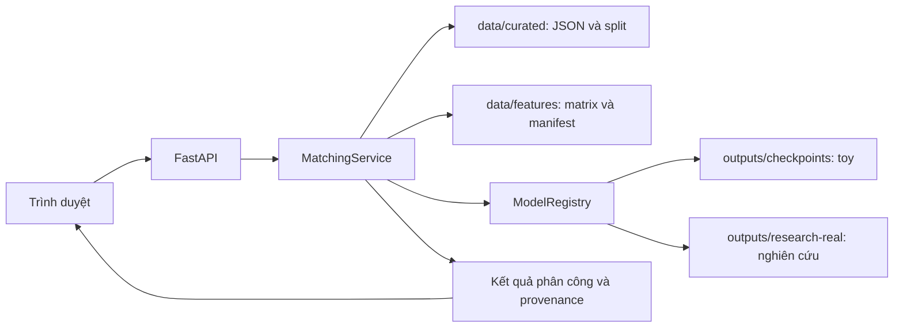

# Lưu dữ liệu và kết nối web KLTN: phương án để review

Ngày kiểm tra: 08/10/2026. Phạm vi: đọc code, metadata và cấu trúc artifact hiện có; chưa upload dữ liệu, sửa implementation, train hoặc deploy. Tài liệu này là đề xuất, không phải báo cáo triển khai.

## 1. Kết luận về hiện trạng

Web đã có đường đọc dữ liệu thực từ snapshot curated trong repo. Vì vậy nhận định “web hoàn toàn chưa có data thật” chưa chính xác. Tuy nhiên hệ thống hiện là công cụ nghiên cứu phân công sinh viên–giảng viên trên dữ liệu lịch sử và môi trường thử nghiệm, chưa phải hệ thống phân công vận hành của trường.

| Thành phần | Hiện trạng đã kiểm tra |
|---|---|
| Dữ liệu curated | 220 đề tài, 38 giảng viên |
| Features | TF-IDF, ma trận tương thích 220 × 38 |
| Split | Train 158, validation 21, test 21, future 20 |
| Bộ mẫu | `sample-2x2`, `sample-3x2`: điểm và quota giả lập |
| Bộ dữ liệu thực trên web | `real-train`, `real-validation`, đọc ma trận từ artifact |
| Test | Không mở cho chạy tương tác; holdout bị khóa |
| Baseline | Hungarian, Greedy, Random tính phân công bằng backend |
| RL toy | Registry nhận checkpoint trong `outputs/checkpoints`, chỉ tương thích bộ mẫu nhỏ |
| RL dữ liệu thực | Registry nhận các bản trong `outputs/research-real`; hiện có DQN và MaskablePPO, trạng thái `unpromoted_research` |
| `outputs/training-smoke` | Không nằm trong thư mục registry quét |
| Tên trên giao diện | API trả nhãn ẩn danh như `GV-001`, không phải tên thật |
| Quota | Chia đều theo `ceil(số sinh viên / số giảng viên)`; giả định nghiên cứu, không phải quota chính thức |
| Quality | `ready=false`; thiếu quota, một phần hồ sơ kỹ năng chưa đầy đủ |

Nguồn kiểm tra: `src/serving/service.py`, `src/serving/model_registry.py`, `backend/app/main.py`, `frontend/app.js`, `data/curated/quality_report_v2.json`, `data/features/feature_manifest_v2.json` và catalog dựng trực tiếp bằng `MatchingService`.

“Mô phỏng” ở đây có hai nghĩa cần phân biệt: bộ mẫu dùng dữ liệu giả; còn replay trên `real-train`/`real-validation` dùng điểm từ dữ liệu curated thật nhưng mô phỏng quyết định phân công với quota thử nghiệm. Hình 3D biểu diễn các bước quyết định, không biến kết quả thành một phân công đã được nhà trường chấp thuận.

Kiểm tra cấu trúc không chứng minh từng hồ sơ đúng hoàn toàn, cũng không chứng minh thuật toán đem lại kết quả phù hợp ngoài thực tế. Quality report còn ghi cần xác minh năm, danh tính và nguồn kỹ năng. `quota` đang thiếu ở toàn bộ 38 bản ghi; tỷ lệ thiếu `skill_text` khoảng 21,1%.

## 2. Những model trong training-smoke có dùng được không?

Đã đọc cả sáu manifest ARS, DQN, MaskablePPO, QRDQN, RecurrentPPO và TRPO: đều `smoke=true`, yêu cầu và hoàn thành 16 timesteps, môi trường `matching-env-v1`.

Đã đọc metadata `data` bên trong các ZIP mà không giải tuần tự pickle: observation shape `[6]`, action count `2`. Đây là không gian toy có hai giảng viên. Contract registry cho dữ liệu thực yêu cầu observation `[114]` và 38 actions.

Vì vậy không thể chỉ upload hoặc chuyển các ZIP này sang thư mục web rồi cho chạy với 38 giảng viên. Hash dataset trong manifest không đủ chứng minh checkpoint thực sự train trên môi trường 38 giảng viên; cần kiểm tra không gian model và môi trường train thực tế.

Các model này nên giữ làm bằng chứng smoke test. Với web nghiên cứu trên dữ liệu thực, ưu tiên đánh giá những checkpoint đã có trong `outputs/research-real` trước khi quyết định train lại. Các manifest đã đọc của DQN tại đây ghi 8.192 timesteps, `curated-train`, `matching-env-v2-real`; registry hiện nhận chúng là nghiên cứu chưa promote. Không coi số bước train hay trạng thái load được là bằng chứng chất lượng.

## 3. Web đang kết nối dữ liệu như thế nào?

Backend nạp `theses.json`, `advisors.json`, `split_indices.json`, `feature_manifest_v2.json` và `compatibility_matrix_v2.npy` khi dựng service. Frontend gọi API cùng origin, không đọc trực tiếp thư mục Windows và không tải model để inference trong trình duyệt.

Các route hiện có:

- `GET /api/v1/catalog`: bộ dữ liệu, baseline và trạng thái checkpoint.
- `GET /api/v1/datasets/{name}`: dữ liệu đã được chuyển thành nhãn hiển thị và ma trận điểm.
- `POST /api/v1/simulate` và `/allocate`: tính phân công; `/allocate` hiện dùng cùng hàm mô phỏng, chưa phải quy trình lưu/phê duyệt phân công chính thức.
- `POST /api/v1/recommend`: xếp hạng giảng viên cho tiêu đề nhập mới bằng TF-IDF trên hồ sơ curated; không phải RL phân công theo quota.

Frontend có đường gọi `/simulate`. Route `/recommend` tồn tại ở backend; chưa xác nhận có một luồng giao diện hoàn chỉnh cho nhập hồ sơ mới.

Artifact hiện được kiểm tra hash, shape, split và thứ tự sinh viên/giảng viên. Một số hash và số lượng được cố định trong `service.py`: thay dữ liệu bằng snapshot mới sẽ cần cập nhật cơ chế contract có phiên bản. Không được bỏ kiểm tra để nạp tùy ý một ma trận khác.

## 4. Nên đẩy data lên đâu?

### Đề xuất ưu tiên cho giai đoạn hiện tại

Nếu chỉ demo hoặc bảo vệ đồ án trên một máy chủ: chạy FastAPI và frontend cùng máy chủ, đặt curated/features cùng checkpoint đã chọn trong persistent volume riêng. Đây là phương án ít thay đổi nhất vì backend đã đọc file theo cấu trúc repo. Chạy local không cần upload cloud.

Nếu cần dữ liệu và model được lưu ngoài máy chủ, đề xuất **bucket private trên Cloudflare R2**, rồi đồng bộ bundle đã chọn về máy chủ trước khi chạy. R2 hỗ trợ API tương thích S3: <https://developers.cloudflare.com/r2/get-started/s3/>. Không cần gọi kho lưu trữ để tải checkpoint lại ở mỗi request.

Nếu mục tiêu sắp tới là nhiều người dùng, quản lý sinh viên/giảng viên/quota theo học kỳ, lưu phân công và feedback: dùng **PostgreSQL** cho dữ liệu nghiệp vụ. Có thể chọn Supabase nếu muốn dịch vụ quản lý database và file chung; Supabase Storage hỗ trợ bucket private với kiểm soát truy cập: <https://supabase.com/docs/guides/storage/buckets/fundamentals>. Đây là giai đoạn mở rộng; chuyển database không tự làm model tốt hơn hay sửa dữ liệu thiếu.

Chưa cần kết hợp nhiều nhà cung cấp ngay. Chọn persistent volume cho demo; bổ sung một kho object private khi cần backup/phân phối artifact; thêm database khi có yêu cầu nhập, sửa và lưu dữ liệu vận hành.

### Phân loại những gì cần lưu

| Loại | Nơi phù hợp | Có cần cho web inference? |
|---|---|---|
| PDF/archive gốc `data/1.pdfs` | Kho file private để lưu nguồn | Không cần tải hết vào web |
| `data/raw`, `data/extracted` | Kho private cho audit/rebuild | Thường không |
| `data/curated` | Snapshot private; về sau có thể import bảng nghiệp vụ | Có, với các file service dùng |
| `data/features` | Bundle artifact có phiên bản | Có |
| `data/embeddings` | Kho artifact nếu feature pipeline đã chọn cần | Serving hiện dùng ma trận TF-IDF, chưa thấy nạp thư mục này |
| Checkpoint `.zip` và manifest `.json` | Bundle private, chọn đúng bản phục vụ | Có nếu chạy RL |
| Benchmark | Artifact cùng phiên bản dữ liệu/model | Cần nếu hiển thị kết quả đánh giá |
| `data/cache` | Giữ local hoặc dựng lại khi cần | Không phải dữ liệu nghiệp vụ cần publish |
| Logs, thư mục test tạm, smoke model | Giữ phục vụ phát triển/audit | Không đưa vào bundle phục vụ mặc định |

Dung lượng kiểm tra xấp xỉ: PDF/archive 1.054,8 MiB; cache 1.081,1 MiB; extracted 53,6 MiB; curated 7,6 MiB; features 0,1 MiB. Như vậy web không cần nguyên thư mục data hơn 2 GiB để chạy nhánh phân công hiện có.

Không đặt raw hồ sơ, model hoặc toàn bộ data trong `frontend/dist` hay public bucket. Chính sách repo hiện yêu cầu giữ nguồn và PII riêng tư, chỉ trả thông tin cần thiết qua API. Tên ẩn danh đang là hành vi chủ động; hiển thị tên thật cần xác định người được phép xem.

## 5. Kết nối cloud với web sau khi được review

Phương án ít thay đổi nhất là **snapshot bundle**:

1. Chọn snapshot curated/features và checkpoint nghiên cứu phù hợp; giữ benchmark và manifest đi kèm.
2. Đóng gói theo phiên bản, ví dụ `releases/<version>/data/...` và `releases/<version>/outputs/...`; giữ nguyên thứ tự ID và hash. Thêm danh sách file/checksum cho cả bundle.
3. Upload vào bucket private; thông tin truy cập chỉ đặt phía backend/deployment.
4. Khi deploy, tải bundle về persistent volume và kiểm tra tính toàn vẹn trước khi khởi tạo service.
5. FastAPI tiếp tục đọc file local và chạy inference CPU như hiện tại. Frontend tiếp tục gọi API hiện có.
6. Giữ bundle trước để rollback; cập nhật snapshot có kiểm soát và khởi động lại service. Không giả định sửa file sẽ tự cập nhật dữ liệu đang nằm trong RAM.

Đây là đề xuất cần triển khai sau review: hiện chưa có downloader/sync R2 được xác nhận trong serving. Nếu mount bundle đúng vị trí dưới product root thì giữ được nhiều code hiện tại; cấu hình data/model root riêng và manifest có phiên bản là cải tiến phù hợp khi triển khai.

## 6. Nếu muốn web phân công dữ liệu vận hành mới

Upload file lên cloud chỉ giải quyết lưu trữ. Để nhận sinh viên mới và phân công thực tế cần thêm hợp đồng dữ liệu:

- Sinh viên: ID ổn định, đề tài/mô tả, học kỳ, thông tin được phép sử dụng.
- Giảng viên: ID, hồ sơ chuyên môn có nguồn, quota chính thức theo học kỳ, số suất đã dùng.
- Phân công: dataset/model version, kết quả đề xuất, trạng thái review/phê duyệt, người phê duyệt.

Luồng dự kiến: nhập hồ sơ → kiểm tra dữ liệu → tạo features bằng preprocessing đã chốt → tính tương thích → baseline hoặc RL tương thích → kiểm tra quota → người phụ trách review → lưu phân công.

RL hiện có action space cố định theo 38 giảng viên. Khi thêm/bớt giảng viên hoặc đổi thứ tự ID phải đánh giá khả năng tương thích và có thể train lại; đổi storage không giải quyết giới hạn này. Hungarian là baseline có sẵn phù hợp để làm mốc kiểm chứng trước khi dùng RL.

## 7. Thứ tự đề xuất sau review

1. Chốt mục tiêu: demo nghiên cứu trên snapshot hay ứng dụng vận hành nhập dữ liệu mới.
2. Kiểm tra và bổ sung quota/nguồn kỹ năng; giữ rõ phần chưa xác minh.
3. Chọn và benchmark checkpoint `research-real` cùng baseline trên validation; giữ test khóa đến khi chốt lựa chọn.
4. Đóng gói snapshot và deploy cùng persistent volume. Bổ sung R2 nếu cần lưu ngoài máy chủ.
5. Chỉ mở rộng PostgreSQL và quy trình phân công được lưu/phê duyệt khi mục tiêu vận hành được xác nhận.

Điều kiện review chính: bạn muốn demo nghiên cứu hay vận hành, có cần tên thật, đã có quota chính thức chưa, và muốn dùng checkpoint nghiên cứu nào. Chưa có upload, sửa code, train lại hoặc deploy trong lần giải thích này.
