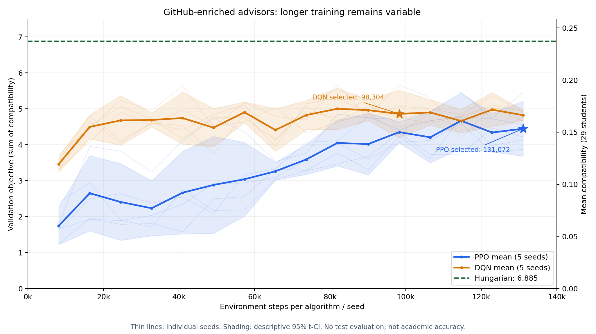
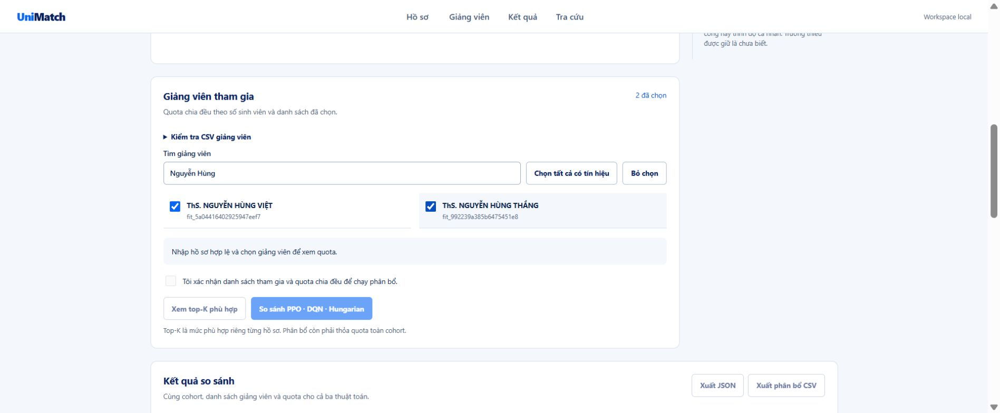

# Bổ sung bằng chứng GitHub và huấn luyện PPO/DQN mở rộng

Ngày lập: 23/10/2026. Trạng thái: **đã kiểm chứng nguồn, features, thí nghiệm và tích hợp; đã kích hoạt local tại cổng 8767**. Cả hai thuật toán chưa đạt tiêu chí plateau.

## 1. Phạm vi và danh tính

Chỉ bổ sung hai giảng viên theo tài khoản do người dùng chỉ định:

| Giảng viên | Nguồn bổ sung | Liên kết danh tính |
|---|---|---|
| ThS. Nguyễn Hùng Thắng | [nhthang9x](https://github.com/nhthang9x) | Người dùng xác nhận |
| ThS. Nguyễn Hùng Việt | [vietnh1009](https://github.com/vietnh1009) | Người dùng xác nhận, bao gồm kinh nghiệm làm việc trước khi về NEU |

Không coi xác nhận này là một kiểm chứng danh tính độc lập trên web. Tên, URL và SHA của hồ sơ chính thức NEU vẫn là mốc danh tính gốc. Bằng chứng GitHub có nguồn, thời điểm tải, commit, đường dẫn và span riêng; không gán nội dung GitHub cho trang NEU.

Nhánh `feat/backup` giữ nguyên bản backup đã push. Công việc bổ sung nằm trên `susois/github-advisor-retraining`. Không ghi đè dữ liệu hoặc gate đã nghiệm thu P0–P8; website hiện hành tiếp tục hoạt động trong khi kiểm chứng phiên bản mới.

## 2. Crawl và mức bao phủ

Run nguồn: `data_rebuild/github_sources/20261022T205024Z-58370a01`.

| Hạng mục | Kết quả |
|---|---:|
| Repository đã liệt kê qua public API | 63: Thắng 26, Việt 37 |
| Repository có nội dung được lấy | 48 |
| Repository trống | 4 |
| Fork/template bị loại khỏi suy luận kỹ năng | 11 |
| Tệp README/dependency/Python được chụp tại commit | 279 |
| Nguồn lưu trữ | 381: 329 HTTP 200 và 52 xác nhận Git HEAD |
| Raw body duy nhất | 345 |
| Lần xuất hiện của bằng chứng | 573 |
| Lỗi tải trong phạm vi đã chọn | 0 |
| Tệp hợp lệ ngoài giới hạn lấy mẫu | 167 |

Giới hạn tối đa 12 tệp/repository được công bố trong manifest. Đã liệt kê hết repository công khai, nhưng **không tuyên bố đọc hết mã nguồn mọi repository**. Không thực thi mã tải về. Repository riêng tư, phần đóng góp ngoài các repository này, chất lượng giảng dạy và mức độ thành thạo không nằm trong phạm vi.

Tất cả 573 lần xuất hiện đã được đối chiếu SHA, raw bytes, nguồn và span. URL file dùng commit cố định; bằng chứng metadata trỏ đúng API JSON và ghi rõ offset thuộc trường JSON. Không dùng vị trí trong description như vị trí trong toàn bộ JSON response.

## 3. Rà soát nhãn

Một đơn vị nhãn là một cặp `(namespace, tag)` của một giảng viên. Cùng một khái niệm có thể xuất hiện ở nhiều namespace theo taxonomy hiện hành; 22 đơn vị không có nghĩa là 22 kỹ năng độc lập.

| Giảng viên | Nhãn ứng viên | Được chấp nhận | Confidence |
|---|---:|---:|---:|
| Nguyễn Hùng Thắng | 11 | 7 | 7/11 = 0,636364 |
| Nguyễn Hùng Việt | 27 | 15 | 15/27 = 0,555556 |
| Tổng | 38 | 22 | 16 đơn vị bị loại |

Confidence dùng đúng rubric người dùng đã duyệt: số đơn vị nhãn qua kiểm tra nguồn, span và ngữ nghĩa chia tổng số đơn vị ứng viên. Đây là chất lượng bằng chứng của lần crawl này, **không phải trình độ, xác suất matching đúng hoặc tỷ lệ hướng dẫn thành công**.

Các nhãn được giữ:

| Giảng viên | Namespace → tags |
|---|---|
| Thắng | `frameworks_libraries`: pytorch, scikit_learn; `ml_ai_methods`: classification; `programming_languages`: java, python; `topic_tags`: computer_vision, nlp |
| Việt | `frameworks_libraries`: pytorch, scikit_learn, tensorflow; `math_statistics_topics`: optimization; `ml_ai_methods`: classification, llm, optimization, reinforcement_learning; `programming_languages`: javascript, python; `research_domain_tags`: ai; `topic_tags`: computer_vision, llm, optimization, reinforcement_learning |

Phân biệt code import/dependency/primary language với README, mô tả và sở thích nghiên cứu. CV/NLP chỉ nêu như sở thích được giữ ở topic khi đủ căn cứ, không tự nâng thành phương pháp đã triển khai. Không lấy toàn bộ dependency của fork, lockfile hoặc hướng dẫn cài đặt làm chuyên môn cá nhân. Các nhãn chỉ có tín hiệu lockfile, công cụ tùy chọn, hướng dẫn Docker, diễn đạt chung về đối tượng độc giả hoặc suy luận ngữ nghĩa không đủ căn cứ đã bị loại.

Mọi nhãn được nhập đều thuộc taxonomy đã duyệt. Không thêm dữ liệu proficiency, outcome, quota hoặc mức sẵn sàng nhận hướng dẫn còn thiếu.

## 4. Kiểm chứng features

Bundle: `data_rebuild/github_rebuild/20261022T205450Z-5ddcb75a`.

| Kiểm tra | Kết quả |
|---|---|
| Sinh viên | 194 đối tượng giữ nguyên |
| Registry/action order | 35 giảng viên, giữ nguyên thứ tự |
| Ma trận | 194 × 35, float64; availability bool |
| Hai giảng viên được bổ sung | Mỗi người từ 0 lên 194 cặp có thể tính điểm |
| 33 cột giảng viên còn lại | Điểm và availability bằng chính xác bản P4 |
| Encoder/IDF | Cùng bytes với P4; không fit lại |
| Taxonomy và hybrid weights | Giữ E4 = 0,25 E1 + 0,25 E2 + 0,50 E3 |
| Split | 135 train / 29 validation / 30 test, bytes giữ nguyên |
| Kịch bản train | 3 bài toán, mỗi bài 45 sinh viên |
| Giảng viên có tín hiệu trong kịch bản | 32, trước đây 30 |
| Observation/action | M35, K78, state472 |

Audit độc lập đã replay encoder trên đủ 194 × 35 cặp. 6.208 cặp có tín hiệu; ba giảng viên còn lại vẫn thiếu tín hiệu theo nguồn hiện có. Có thể tính điểm không đảm bảo điểm lớn hoặc phù hợp với mọi đề tài.

Do features và tập giảng viên được tham gia thay đổi, mô hình train **từ đầu**. Cùng kích thước observation không đủ để coi checkpoint cũ tương thích về ngữ nghĩa.

## 5. Thiết kế thí nghiệm mở rộng

Run: `data_rebuild/github_training/github_retraining_runs/20261022T205827Z-16010d68`.

- PPO và Double DQN native hiện hành; giữ hyperparameters, reward và quota policy.
- Mỗi thuật toán dùng 5 seed: 42–46. Tổng 10 job độc lập, mỗi job 131.072 environment steps; tổng 1.310.720 bước.
- Đánh giá validation mỗi **8.192** bước, từ 8.192 đến 131.072: 16 điểm/seed/thuật toán.
- Lưu và tải lại checkpoint tại **16.384; 24.576; 32.768; 49.152; 65.536; 98.304; 131.072**.
- DQN giảm epsilon từ 1 xuống 0,05 trong 16.384 bước đầu, sau đó giữ 0,05. Native `learn` reset môi trường train ở đầu mỗi chunk; PPO giữ live rollout state giữa các chunk.
- Evaluation và kiểm tra reload khôi phục RNG Torch/Python/NumPy để không thay chuỗi ngẫu nhiên của mô hình đang học.
- Test30 không được chấm hoặc dùng chọn checkpoint trong thí nghiệm này. Test30 từng được xem ở P5, nên không gọi đây là holdout chưa từng được sử dụng.
- Baseline Hungarian, greedy và random chạy trên cùng validation và roster mới.

Lựa chọn checkpoint theo objective trung bình của đủ 5 seed tại bảy mốc đã công bố, yêu cầu allocation hợp lệ, replay/reload khớp; representative seed42 không được kém mốc 16.384 của chính seed đó. Hòa chọn mốc sớm hơn. Không chọn theo loss nhỏ nhất hay test.

Máy hiện dùng một worker theo admission guard RAM; Torch một thread/process. Giới hạn RAM được đo từ fixture và có dự phòng, không được diễn giải thành bảo đảm peak RAM cho mọi workload.

## 6. Cách đọc hội tụ và các điều kiện nghiệm thu

Tăng steps có thể tăng, giảm hoặc giữ điểm. PPO loss và DQN loss có định nghĩa khác nhau; không so trực tiếp và không gọi là accuracy. Metric `objective` là tổng utility của các cặp được chọn; trong run này preference chưa có nguồn và bằng 0, nên khi đủ 29 sinh viên, `objective = 29 × mean_compatibility`. Coverage và vi phạm là các kiểm tra riêng. Reward huấn luyện còn có fairness shaping và terminal completion; không lấy tổng reward hoặc loss làm thay thế cho objective đánh giá.

Validation không tăng theo một lượng cố định sau mỗi step. Mô hình được chụp mỗi 8.192 bước; tại mỗi lần chụp, policy chọn giảng viên theo action hợp lệ, rồi quota còn lại tác động các quyết định tiếp theo. Đổi một quyết định có thể đổi cả chuỗi phân bổ. Với các cặp còn lại giữ nguyên, thay điểm một cặp từ `a` sang `b` làm mean compatibility đổi `(b-a)/29`; không có bước nhảy điểm chung cho mọi lần train.

Weights và probability/Q-value có thể thay đổi trong khi allocation và objective vẫn giữ nguyên, vì lựa chọn argmax chưa đổi. Một lần cập nhật tiếp theo vẫn có thể vượt ranh giới quyết định và làm điểm tăng hoặc giảm. Vì vậy đoạn đồ thị phẳng, loss thấp hoặc một checkpoint tốt không đủ để kết luận train lâu hơn sẽ không tăng nữa.

Tiêu chí plateau thực dụng đã công bố trước: range của **mean compatibility qua 5 seed** ở ba mốc validation cuối (114.688; 122.880; 131.072) không quá 0,005. Báo cáo kèm paired 95% t-CI và slope trên mỗi 8.192 bước. Đây là mô tả trong ngân sách đã thử, không chứng minh hội tụ toán học hay đảm bảo train lâu hơn không tăng tiếp. Khoảng tin cậy không hiệu chỉnh cho việc so nhiều checkpoint; năm seed trên một validation29 không đo chất lượng ở học kỳ mới.

Không quy chênh lệch giữa run cũ và mới hoàn toàn cho số bước: nguồn giảng viên, roster và khởi tạo đã đổi. Chỉ so hiệu ứng steps trong cùng bundle mới. Muốn đo accuracy học thuật cần relevance/outcome có kiểm duyệt từ điều phối hoặc kết quả thực tế.

Điều kiện trước kích hoạt local:

1. Nguồn và bundle đạt kiểm chứng độc lập; source/hash/span, 33 cột không đổi và split được bảo toàn.
2. Đủ 10 job, 160 lần đánh giá, 70 checkpoint reload; weights thực sự đổi, optimizer logs hữu hạn, trace replay đúng, coverage 100%, không vi phạm/invalid action.
3. Đủ curves từng seed/mean/std/CI, baseline, checkpoint được chọn và kết quả plateau đúng thực nghiệm.
4. Loader ghép đúng bytes bundle đã train, encoder/native contract/checkpoint; từ chối dữ liệu sai hoặc không đủ manifest.
5. Test hồi quy, frontend check/build và luồng CSV → quota → PPO/DQN → review/export/trích dẫn đạt; không học trong API request.
6. Chỉ chuyển local sau kiểm chứng; giữ lệnh chạy bản cũ để rollback. Không tự tuyên bố production/cloud promotion.

## 7. Kết quả huấn luyện và tích hợp

Đã chạy đủ 10 job, tổng **1.310.720 environment steps**, 160 lần đánh giá validation và 70 checkpoint được lưu/tải lại. Coverage 100%, không constraint violation hoặc invalid action; mọi trace replay và checkpoint reload khớp. Weights thay đổi thật tại đủ 160 chunk. Test30 không được chấm. Tổng thời gian train đo được **6.028,539 giây (~100,48 phút)**; peak working set tích lũy của worker là **714,50 MiB**.

Objective dưới đây là **mean ± sample std qua 5 seed** trên cùng validation29:

| Environment steps | PPO | Double DQN |
|---:|---:|---:|
| 16.384 | 2,652107 ± 0,842698 | 4,497106 ± 0,269342 |
| 24.576 | 2,408399 ± 0,859405 | 4,677909 ± 0,555519 |
| 32.768 | 2,234318 ± 0,617007 | 4,690669 ± 0,156472 |
| 49.152 | 2,882871 ± 1,086833 | 4,475183 ± 0,428838 |
| 65.536 | 3,262270 ± 0,198227 | 4,410424 ± 0,477230 |
| 98.304 | 4,352206 ± 0,239434 | **4,858823 ± 0,533106** |
| 131.072 | **4,446987 ± 0,616170** | 4,822281 ± 0,116247 |

Chọn **PPO 131.072** và **DQN 98.304**, representative seed42 theo quy tắc công bố trước. Điểm trong bảng là trung bình 5 seed, không phải điểm riêng của checkpoint seed42 được nạp vào website. Các mốc dense ngoài bảy milestone vẫn được báo cáo đầy đủ trong đồ thị/JSON; không đổi quy tắc để chọn ngược một mốc chưa được khai báo lưu checkpoint.

So với 16.384 bước trong **cùng bundle mới**:

- PPO tại checkpoint được chọn tăng objective trung bình **+1,794879**, paired 95% CI **[+1,152457; +2,437301]**. Dữ liệu validation này ủng hộ cải thiện khi train dài hơn.
- DQN tại checkpoint được chọn tăng trung bình **+0,361717**, paired 95% CI **[-0,271082; +0,994516]**. Khoảng tin cậy còn chứa 0; chưa đủ căn cứ khẳng định mức cải thiện ổn định qua seed.
- Hungarian đạt objective **6,885236**, mean compatibility **0,237422**, cao hơn cả hai mô hình. Không tuyên bố PPO/DQN vượt baseline tối ưu này.

**Cả hai chưa đạt plateau theo tiêu chí đã chốt**:

| Thuật toán | Mean compatibility tại 114.688 / 122.880 / 131.072 | Range | Ngưỡng | Kết quả |
|---|---|---:|---:|---|
| PPO | 0,160953 / 0,149668 / 0,153344 | 0,011285 | ≤ 0,005 | Không đạt |
| DQN | 0,160714 / 0,171625 / 0,166286 | 0,010911 | ≤ 0,005 | Không đạt |

Vì vậy, thí nghiệm **không chứng minh hội tụ tại mốc cũ hoặc tại 131.072 bước**. PPO vẫn cải thiện đáng kể so với mốc đầu trong bundle mới; cả hai tiếp tục dao động ở đoạn cuối. Train thêm vẫn có thể tăng hoặc giảm điểm. Không tăng budget vô hạn hoặc thay ngưỡng sau khi nhìn kết quả để tạo một kết luận hội tụ.



Số liệu đầy đủ từng seed, 32 điểm mean/std/CI, paired comparisons, plateau và runtime: [JSON đã loại hồ sơ/assignments/token](validation/github_retraining_numeric_20261023.json). Có thêm [SVG](assets/github_retraining_validation_20261023.svg) để xuất hình.

Gate kỹ thuật của experiment và nghiệm thu local: `verified`. Gate này xác nhận tính đầy đủ/hợp lệ của thí nghiệm và luồng ứng dụng, không xác nhận plateau, accuracy học thuật hoặc production promotion.

### Kiểm thử và nghiệm thu local

- Hồi quy cuối: **467 passed, 1 skipped, 4 warnings**, 123,62 giây, lệnh `PYTEST_DISABLE_PLUGIN_AUTOLOAD=1 python -m pytest tests/rebuild -q`, Torch/OMP/MKL một thread. Một test tạo symlink thật cần quyền Windows được bỏ qua; các kiểm tra traversal, đường dẫn private và ASGI static privacy vẫn đạt. Warnings gồm một cảnh báo dependency requests của environment hiện có và ba cảnh báo deprecation action masks của Gymnasium.
- Frontend `check` và `build` đạt; không thay đổi mã giao diện trong phần bổ sung này.
- HTTP thật: 17 kiểm tra đạt, gồm auth, 35 hồ sơ/32 có tín hiệu, hai giảng viên được bật, bytes bundle/model đúng, nhập ba hồ sơ thật đủ 40 cột, quota 2/1, sáu điểm top-K bằng chính xác ma trận đóng băng, chặn chạy khi chưa xác nhận, ba thuật toán hợp lệ, lưu/readback và xuất CSV, trích dẫn hai giảng viên, không public cohort qua static.
- Chrome: nhập cùng CSV, kiểm tra quota, top-K, bảng so sánh PPO/DQN/Hungarian, replay tiến/lùi PPO, đổi sang trace DQN và mở trích dẫn GitHub tại commit kèm thời gian/SHA. Console không có lỗi. Đây là kiểm thử chức năng desktop; ba hồ sơ vốn có trong gold không phải tập đánh giá mới.
- Audit độc lập xác minh đủ **599 artifact, 70 checkpoint**, code gốc đã lưu, isolation train/validation và probability/Q vectors của **58 quyết định** phục vụ thực tế khớp trace checkpoint đã lưu. Review code cuối không còn phát hiện cần sửa.
- Sau khi các kiểm tra đạt, dừng đúng server cũ, mở launcher mới tại `127.0.0.1:8767`, xác minh `/health` ready, bundle SHA, PPO 131.072/DQN 98.304 và roster 32 có tín hiệu qua HTTP và Chrome. Server kiểm thử 8768 đã dừng. Runtime và artifacts cũ được giữ để rollback.

Giới hạn tra cứu đã quan sát: encoder E0/E1 đóng băng chưa có các từ `python`, `pytorch`, `classification`, `text`, `computer`, `vision`. Một truy vấn chỉ gồm công nghệ mới như “Python PyTorch phân loại văn bản” có thể không tạo xếp hạng topic. Tra cứu theo tên hai giảng viên vẫn trả đúng bằng chứng GitHub; matching CSV đủ features vẫn dùng các nhãn có nguồn qua E3. Không tự tạo tag/confidence từ truy vấn hoặc fit lại vocabulary để làm đẹp kết quả. Muốn mở rộng truy vấn cần một phiên bản encoder riêng và kiểm chứng lại.

Sau khi train xong có gia cố entrypoint cho **các lần chạy tương lai**: CLI/coordinator/worker đều dùng validator bundle chung, kiểm tra code/source manifest trước/sau chạy và trả exit code lỗi khi technical gate không đạt. Bản train thực tế dùng đúng code gốc đã lưu trong thư mục provenance; không train lại hoặc sửa checkpoint để gán các gia cố này vào lịch sử. Serving buộc SHA bundle trùng bytes đầu vào của run và chặn runtime/token thoát vùng private, bao gồm đường dẫn vào frontend.

Bằng chứng nghiệm thu riêng tư: `data_rebuild/runtime/qa/github_http_integration.json`, `github_chrome_integration.json`, `github_activated_bootstrap.json`; gate và manifest tổng hợp tại `data_rebuild/github_release/local_20261023/`. Gate lưu hash các báo cáo độc lập, code hiện hành, bundle/selection và bằng chứng kiểm thử. Không chứa token hoặc phân công chính thức.



## 8. Truy xuất bằng chứng

- Crawl manifest SHA-256: `d23d957255ceb452266c2aba3e8206c008509c590cac4e9f489500c154cadc46`.
- Review nhãn: `data_rebuild/github_sources/review/20261022T205024Z-58370a01_independent.json`, SHA `5d1576cffa56e32e5c3eea94af7bec539897ddc79398384695482cf9605a670f`.
- Review features: `data_rebuild/github_sources/review/20261022T205450Z-5ddcb75a_feature_independent.json`, SHA `54d99d3c9382b96aab9dc7624ecc2a094431f3650e3fe237b17239643fa827c8`.
- Training bundle SHA: `fc0208424d876c7cb45fb350d6d1a7a3412f6f3fda45999db232f8fbfd6b176b`.
- Native feature contract SHA: `f34bf84058b738ef0a1b8a5adf2434b5febea5e1acdb70b96953978b742f20a4`.
- Manifest thí nghiệm (599 artifact): `4ab51ddc1ee7b9ced6b3e9e77f4c731acfffc0a82df3c468de2d7d2eab49778f`.
- Selection manifest SHA: `d563de389828e57ab7040843805710477809908a27ea9493a38c8b7d55f4dba4`.

Raw nguồn, hồ sơ sinh viên và checkpoint nằm trong `data_rebuild/` bị Git ignore. Báo cáo công khai chỉ xuất số liệu tổng hợp, không đưa token, hồ sơ sinh viên hoặc assignments thật vào Git.

## 9. Lệnh vận hành

Các đường dẫn dưới đây thuộc checkout local hiện tại. Manifest chứa đường dẫn tuyệt đối; không tự sửa manifest/hash để chuyển máy hoặc bỏ qua kiểm tra.

```powershell
python -m pip install -r requirements-github-rebuild.txt

# Chỉ kiểm tra bundle, không train:
python scripts/train_github_advisor_models.py --bundle data_rebuild/github_rebuild/20261022T205450Z-5ddcb75a/training_bundle.json --output data_rebuild/github_training

# Train lại tạo run mới, không ghi đè run hiện tại:
python scripts/train_github_advisor_models.py --bundle data_rebuild/github_rebuild/20261022T205450Z-5ddcb75a/training_bundle.json --output data_rebuild/github_training --max-workers 2 --execute

# Chỉ chạy sau khi selection và nghiệm thu local đã verified:
python scripts/serve_github_unimatch_local.py --bundle data_rebuild/github_rebuild/20261022T205450Z-5ddcb75a/training_bundle.json --selection data_rebuild/github_training/github_retraining_runs/20261022T205827Z-16010d68/selection_manifest.json --port 8767
```

Mở `http://127.0.0.1:8767/rebuild.html`. Launcher mới reuse file token riêng tư `data_rebuild/runtime/access.token`, chỉ bind loopback và không in token. Giữ luồng CSV/quota/review/export và trợ lý deterministic của bản trước. CSV mới chỉ phục vụ inference; không tự nhập vào gold hoặc train. Tải model/manifest sai khiến launcher từ chối khởi động, không âm thầm quay sang checkpoint khác.

Runtime/token chỉ được đặt dưới `data_rebuild/runtime` hoặc `data_rebuild/v1/runtime`; đường dẫn chuẩn hóa thoát khỏi hai vùng này bị từ chối. Không cho đặt runtime/token vào frontend hoặc thư mục artifact đã đóng băng.

Sau khi đổi bundle, tải lại trang và nhập lại CSV để tạo cohort gắn với phiên bản mới. Cohort/run cũ được giữ ở runtime của bản trước; không tự gán lại phiên bản cho dữ liệu hoặc đề xuất đã lưu. Có thể chạy launcher cũ để đọc lại đúng phiên bản đó.

Rollback: dừng đúng process server mới, rồi chạy `python scripts/serve_unimatch_local.py --port 8767`. Lệnh này vẫn mở bundle/selection cũ. Không hoàn tác các đề xuất hoặc phân công con người đã duyệt chỉ bằng rollback model.

Source code, checkpoint, data và nguồn crawl là các phần độc lập của khả năng tái lập. Bản sao chính xác 10 file code đã đóng băng của thí nghiệm này nằm tại `data_rebuild/github_training/provenance/20261022T205827Z-16010d68`, manifest SHA `3d0b13f8ae5c01aef2bf5af7e52860d6d6197e9a60b50c29b4041cbda1e2fb82`. Các lần gia cố entrypoint sau thí nghiệm phải được ghi riêng, không được mô tả như mô hình đã train bằng phiên bản code chưa tồn tại lúc chạy.
