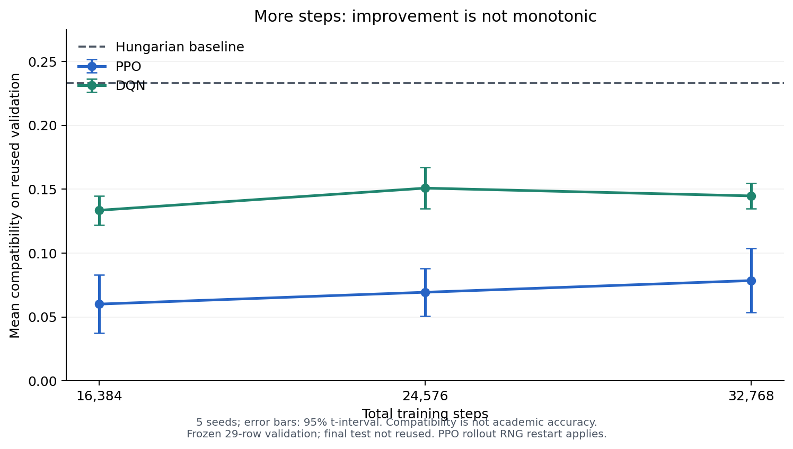

# UniMatch — tăng số bước huấn luyện và chất lượng matching

Ngày địa phương: 23/10/2026. Run: `20261022T185701Z-ba772936`.

## Kết luận

**Đã có PPO/DQN thật và đã chạy thêm bước huấn luyện. Tăng step không bảo đảm tăng chất lượng.** DQN cải thiện nhất ở 24.576 bước trong các mức đã thử, sau đó điểm trung bình giảm ở 32.768. PPO tăng trung bình, nhưng khoảng tin cậy chênh lệch còn chứa 0. Cả hai vẫn thấp hơn Hungarian trên validation hiện tại; không promote thành mô hình vận hành mặc định.

Không có nhãn “phân công đúng” hoặc kết quả hướng dẫn thực tế để tính academic accuracy. Báo cáo đo compatibility/objective theo feature đã duyệt, coverage, constraint, loss và tính tái lập; không đổi tên các chỉ số này thành accuracy.

## Thiết kế thí nghiệm khóa trước kết quả

- Nguồn chuẩn P3: 194 sinh viên/35 giảng viên đã duyệt; raw 220 tài liệu, 219 SHA duy nhất. Folder bổ sung 20 PDF đều trùng nguồn cũ. Không dùng bộ 215 legacy làm chuẩn.
- Chỉ học trên 135 hồ sơ train, ba cohort rời nhau. 29 validation để đo learning curve/chọn stage; 30 final-test giữ reserved, không đánh giá lại để tuning.
- Năm seed 42–46. Parent 16.384 bước; tiếp tục đến 24.576 và 32.768, thêm 8.192 bước mỗi stage. Tổng 20 checkpoint mới, 163.840 transition bổ sung cho hai thuật toán/năm seed.
- Vocabulary/IDF, E4 weights, taxonomy K=78, action registry M=35, state 472 chiều, quota/reward/mask giữ nguyên. Không refit feature hoặc học từ validation/upload.
- PPO khôi phục policy/Adam/counter, rollout mới. DQN khôi phục online/target/optimizer/replay, epsilon cố định 0,05 ở cả hai stage.
- Hungarian chạy trên cùng validation/cohort/constraint làm baseline. Chọn stage theo mean validation trên năm seed, representative seed 42 được chốt trước; không chọn seed tốt nhất sau khi xem kết quả. Ties ưu tiên stage sớm hơn.

## Kết quả

| Thuật toán | Tổng step | Objective trung bình | Compatibility trung bình |
|---|---:|---:|---:|
| PPO | 16.384 | 1,741777 | 0,060061 |
| PPO | 24.576 | 2,010664 | 0,069333 |
| PPO | 32.768 | 2,276035 | 0,078484 |
| DQN | 16.384 | 3,871415 | 0,133497 |
| DQN | 24.576 | 4,374316 | 0,150838 |
| DQN | 32.768 | 4,197636 | 0,144746 |
| Hungarian | Không training | 6,756726 | 0,232991 |

Paired delta objective và 95% t-interval trên năm seed:

- PPO 16.384 → 32.768: **+0,534258**, CI **[-0,430890; 1,499406]**. Chưa đủ bằng chứng ổn định để kết luận cải thiện tổng quát.
- DQN 16.384 → 24.576: **+0,502901**, CI **[0,269401; 0,736400]**; cả năm seed cải thiện tại stage này trên validation đang dùng.
- DQN 24.576 → 32.768: **-0,176680**, CI **[-0,706342; 0,352981]**. Không đơn điệu; thêm step không tự trở thành lợi ích.

Mean logged optimizer loss DQN giảm khoảng 0,012963 → 0,010827 → 0,010240, trong khi matching score giảm ở stage cuối. Loss thấp hơn không đồng nghĩa phân bổ tốt hơn. Ba mức step chưa chứng minh hội tụ hoàn toàn.

## Checkpoint dùng cho so sánh local

Selection manifest đã đóng băng chọn **PPO 32.768 / DQN 24.576**, đều seed 42. Đây là model nghiên cứu được tải cho đề xuất/comparison local, không phải promotion production.

- Native contract SHA: `db39c33a53ece921d06aa0b00786b352f01aba57ff21e92d867def40e058b1e8`.
- PPO checkpoint SHA: `be18ff9a3664afa20d9354838e440af3ec83a2d19b1f153b347cefcad78a391c`.
- DQN checkpoint SHA: `15aa46eef382123a7048b55530917efde7b72c1b953887fb747bbc2d291955c8`.
- Manifest run SHA: `be26004b27586f1c768dbbe519da6f782f6a0d448b58eff210dfb73e379c7180`.
- Selection SHA: `9fc530e764805ee61630d482ca98e2a84af9721d9a7106cf20df6bb41851bea9`.

117 artifact được agent độc lập kiểm tra SHA. Cả hai selected checkpoint được tải hai lần theo native contract; trace và vector policy/Q khớp bản đã đóng băng. Coverage 100%, 0 constraint violation, 0 invalid action trên toàn bộ phép đo validation. Code/config không đổi trong run; final test không được chạy.

## Giới hạn

- Validation đã được dùng trước đây trong P4/P5; kết quả là nghiên cứu trên holdout phi thời gian tái sử dụng, không phải đánh giá kỳ mới độc lập.
- PPO native load/reload gọi thiết lập seed SB3 và có thể khởi tạo lại global Torch RNG trước stage kế tiếp. Protocol là continuation có rollout được seed lại; không tương đương một run liên tục không ngắt. Không quy mọi chênh lệch riêng cho số step.
- Vocabulary/IDF và evidence còn hạn chế; toàn bộ abstract trong gold hiện thiếu. Thêm step không tạo thêm thông tin hoặc nhãn chất lượng.
- Không có outcome/prospective accuracy hoặc temporal forgetting đo được. Theo chỉ đạo mới, thiếu xác minh học kỳ không chặn release local; vẫn ghi rõ giới hạn này.
- Tăng step tiếp vô hạn không được biện minh bởi kết quả hiện tại. Ưu tiên đánh giá hồ sơ CSV thật mới và cải thiện nguồn/nhãn/feature trước khi chi thêm budget.

## Nghiệm thu P6 theo phạm vi mới

Gate `data_rebuild/v1/reports/phase6_local_gate.json`: **verified**, `can_start_phase7=true`, scope `owner_authorized_local_non_temporal`. Gate tham chiếu receipt chỉ đạo trực tiếp, manifest rehearsal P6 cũ và manifest convergence mới. Báo cáo/gate partial P6 cũ được giữ nguyên như lịch sử; không sửa artifact để giả như đã có temporal proof.

Code thí nghiệm: `src/evaluation/rl_convergence.py`; chạy `python scripts/evaluate_rl_convergence.py`. Kết quả riêng tư, learning curves, paired CI và selection tại `data_rebuild/v1/convergence_runs/20261022T185701Z-ba772936/`.
