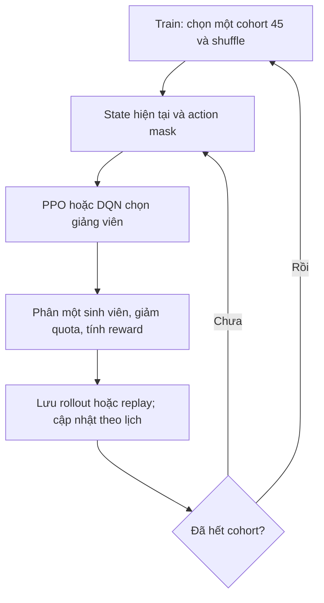

# Giải thích kết quả PPO/DQN, vòng lặp huấn luyện và hồ sơ thiếu tín hiệu

Ngày đối chiếu: 23/10/2026. Run tăng step: `20261022T185701Z-ba772936`. Tài liệu đối chiếu trực tiếp code, JSON kết quả và trạng thái optimizer trong checkpoint; không chạy thêm training hoặc chạy lại test30.

## 1. Bản backup đã lưu gì?

Commit **`e65b3c138ffa18d1c288549dfce065656d0e2e9a`** lưu trạng thái rebuild trên nhánh `feature/task-01-to-21-completion`. Đã push và đối chiếu SHA remote. Repository cũ `namhv521/Matching_system_ReinforcementLearning` được GitHub chuyển tới [namhv521/UniMatch](https://github.com/namhv521/UniMatch/tree/feature/task-01-to-21-completion).

Bản này gồm source, frontend, tests, dependency/config/taxonomy, báo cáo, biểu đồ và [35 hàng số đo theo seed cùng thống kê ghép cặp](validation/rebuild_numeric_backup_20261023.json). Các file đã bị xóa trong working tree được giữ đúng trạng thái xóa của đợt rebuild. Đã sửa `.gitignore` từ `data/` thành `/data/`, vì mẫu cũ vô tình bỏ qua cả `configs/data/`.

**Đây là backup code/config/số đo và hash, không phải backup đầy đủ dataset hoặc model weights.** Raw PDF/DOCX/RAR, hồ sơ sinh viên, checkpoint/encoder binaries, runtime và token vẫn nằm riêng tư trong `data/`, `data_rebuild/`, `outputs/`. Không ép thêm chúng lên Git. Khôi phục inference đầy đủ cần khôi phục cả private artifacts đúng hash/path theo runbook; chỉ clone Git sẽ chưa tải được model.

Với manifest kiểm tra byte nguồn, nên clone bằng `git -c core.autocrlf=false clone ...` để tránh đổi LF thành CRLF. Không sửa hash để ép artifact khác thành tương thích. Các script kiểm tra sẽ fail closed nếu chưa có private artifacts.

Test trên trạng thái backup: **399 passed, hai warning deprecation Gymnasium**; lần kiểm tra trước commit mất 72,32 giây trên máy local. Không coi số test phần mềm là số hồ sơ hoặc số nhãn accuracy.

## 2. Đính chính: chưa chứng minh PPO/DQN đã hội tụ

**PPO 32.768 và DQN 24.576 là checkpoint được chọn trong ngân sách đã thử. Chúng không phải những ngưỡng mà mô hình được chứng minh đã hội tụ.**

Thí nghiệm chỉ đo ba mốc tổng số bước: **16.384, 24.576 và 32.768**, trên năm seed. Chưa đo 50.000, 100.000 hay một triệu bước. Chưa có điều kiện plateau được kiểm tra qua nhiều cửa sổ đánh giá. Vì thế không thể suy ra mô hình sẽ không tăng lại sau 32.768 bước.

Phân biệt các giá trị:

| Giá trị | Ý nghĩa | Có phải accuracy/hội tụ không? |
|---|---|---|
| Tổng step, ví dụ 32.768 | Số lần tương tác với environment trong một model/seed | Không |
| Loss | Đại lượng optimizer đang tối ưu; PPO và DQN dùng loss khác nhau | Không |
| Compatibility E4 | Điểm phù hợp của một cặp theo feature đã duyệt, trong [0,1] | Không phải tỷ lệ phân công đúng |
| Objective | Tổng utility của toàn cohort | Không phải loss hoặc shaped return |
| PPO probability | Xác suất policy chọn action ở trạng thái hiện tại, sau mask | Không phải xác suất hướng dẫn thành công |
| DQN Q-value | Ước lượng discounted return khi chọn action ở trạng thái đó | Không phải xác suất; không bắt buộc thuộc [0,1] |
| Coverage/violation | Đủ phân bổ và có tuân ràng buộc không | Đánh giá tính hợp lệ, chưa đánh giá chất lượng học vụ |

PPO probability/Q-value thay đổi theo sinh viên, tải, quota và mask. Không có một con số chung duy nhất phải tăng dần cho mọi giảng viên trong mọi lượt chạy.

## 3. Đang dùng dữ liệu nào để học và đánh giá?

Nguồn chuẩn hiện tại: 220 tài liệu gốc local, 219 hash duy nhất; snapshot đã duyệt gồm **194 sinh viên và 35 giảng viên**. Folder bổ sung chứa 20 PDF đều trùng nguồn đã kiểm kê. Không dùng bộ 215 hồ sơ cũ làm chuẩn.

| Tập | Quy mô | Cách sử dụng |
|---|---:|---|
| Train | 135 sinh viên | Chia ba cohort rời nhau, mỗi cohort 45; dùng tạo rollout/replay và cập nhật trọng số |
| Validation | 29 sinh viên | Đánh giá parent và các checkpoint tăng step; chọn mốc theo kết quả năm seed |
| Test | 30 sinh viên | Đã đánh giá parent 16.384 bước tại Phase 5; không chạy lại để chọn checkpoint trong thí nghiệm tăng step |
| CSV mới trên frontend | Do người dùng nhập | Inference trên model đã tải; không tự thêm vào train, không tự tạo nhãn đúng |

**Test30 đã từng được xem ở Phase 5.** Không gọi nó là tập chưa bao giờ được sử dụng. Kết quả test30 cũ không được gán cho checkpoint 24.576/32.768. Hiện chưa có kết quả final-test độc lập mới cho hai checkpoint được chọn.

Validation29 cũng đã được sử dụng ở các phase trước. Năm seed đo biến thiên do training trên cùng tập cố định, không tương đương năm bộ dữ liệu/học kỳ độc lập. Theo yêu cầu mới không bắt xác minh học kỳ; việc đó không biến split phi thời gian thành bằng chứng dự báo kỳ tiếp theo.

Nguồn code: `src/data_pipeline/rebuild_cohorts.py`, `src/evaluation/rebuild_benchmark.py::_evaluation_problems`, `src/evaluation/rl_convergence.py::validate_training_suite`.

## 4. Điểm đầu vào do thành phần nào tính?

PPO/DQN không trực tiếp đọc lại toàn bộ PDF mỗi lần chạy. Pipeline nguồn đã tạo gold có provenance; frozen feature pipeline tạo ma trận điểm:

- **E1:** cosine TF-IDF của tiêu đề/tóm tắt sinh viên và `research_description` giảng viên. Toàn bộ abstract gold hiện thiếu, nên phần sinh viên chủ yếu từ tiêu đề.
- **E2:** Jaccard trên domain/topic tags có bằng chứng.
- **E3:** Jaccard trên technical tags, nhân `sqrt(skill_confidence × expertise_confidence)` khi cả hai confidence hợp lệ. Confidence là tỷ lệ bằng chứng hợp lệ theo rubric, không phải trình độ.
- **E4:** kết hợp trọng số đã duyệt **E1=0,25; E2=0,25; E3=0,50**, chuẩn hóa lại trên các thành phần thực sự có dữ liệu.

Với cặp `(i,j)` và tập thành phần khả dụng `A_ij`:

```text
E4(i,j) = sum(w_k * E_k(i,j), k thuộc A_ij) / sum(w_k, k thuộc A_ij)
```

Nếu mẫu số bằng 0 thì `available=False`, không có điểm quan sát được. Trọng số 0,25/0,25/0,50 giữ nguyên trong thí nghiệm tăng step. Vocabulary/IDF chỉ fit bằng train, rồi đóng băng; upload không fit lại.

PPO/DQN học cách chọn một chuỗi action dưới quota từ các feature/state này. Thêm step không tự bổ sung tóm tắt, nghiên cứu giảng viên, skill hoặc outcome còn thiếu.

Nguồn: `src/features/rebuild_features.py::fit`, `::transform_score`; feature contract P4.

## 5. Một episode và một step diễn ra thế nào?

**Một step là phân một sinh viên hiện tại cho một giảng viên hợp lệ.** Một episode train hoàn tất một cohort 45 sinh viên, tức 45 step. Không phải một step bằng một lượt đọc hết 135 hồ sơ.

Khi train, environment chọn một trong ba cohort và shuffle thứ tự sinh viên. Mỗi step:

1. Tạo state: điểm các giảng viên cho sinh viên hiện tại, quota/tải, mask, vector nguồn và thông tin tổng hợp về sinh viên còn lại.
2. Tạo action mask: còn capacity, có dữ liệu điểm, có mặt trong roster, đủ eligibility, thỏa fixed assignment và còn một phương án phân hết những sinh viên phía sau.
3. Policy PPO hoặc mạng Q DQN chọn action trong mask.
4. Trừ quota một đơn vị, cập nhật tải, chuyển sinh viên tiếp theo, nhận reward.
5. Lưu transition/rollout; cập nhật trọng số theo lịch riêng của thuật toán.
6. Khi đủ cohort, kiểm tra assignment, kết thúc episode rồi reset.



Registry có **35 action**, giữ nguyên ID/order. State **472 chiều = 9×35 + 2×78 + 1**. Có 30 profile đủ tín hiệu dùng trong research suite. Các nhóm action thiếu dữ liệu vẫn giữ vị trí trong registry, nhưng bị mask.

State có điểm của sinh viên hiện tại và demand fraction tổng hợp của phần còn lại; **không đưa toàn bộ ma trận điểm của mọi sinh viên tương lai vào mạng**. Mask kiểm tra khả thi phần còn lại bằng solver, nhưng solver này không chọn hộ action có chất lượng tối ưu cho PPO/DQN.

Reward thực tế:

```text
r_t = score_t + 0,1 * observed_preference_t
      + 0,15 * (Phi_after - Phi_before)
      + 1 nếu hoàn tất cohort

Phi = -variance(load / capacity)
```

Preferences hiện chưa quan sát/xác nhận nên không tự tạo preference để tăng reward. `gamma=0,99` chiết khấu reward tương lai. Objective báo cáo là tổng utility không chiết khấu; hiện tương ứng tổng compatibility. Vì vậy objective và discounted shaped return không phải cùng một đại lượng.

Fairness shaping hiện dùng `Phi_after-Phi_before`, không phải `gamma*Phi_after-Phi_before`; tài liệu này không khẳng định nó bảo toàn policy tối ưu theo một định lý shaping khác. Terminal bonus giống nhau khi mọi episode hoàn tất cũng không chứng minh chất lượng từng cặp tốt.

Nguồn: `src/environment/rebuild_env.py`, `src/domain/rebuild_matching.py::action_mask`, `src/evaluation/rebuild_benchmark.py::_metrics`.

## 6. Lịch cập nhật trọng số và lịch đo khác nhau thế nào?

### PPO

UniMatch dùng `sb3_contrib.MaskablePPO`: thu rollout rồi tối ưu nhiều epoch trên minibatch. Cách xen kẽ thu thập dữ liệu và tối ưu nhiều epoch là cơ chế của [PPO gốc](https://arxiv.org/abs/1707.06347); các con số dưới đây được đọc từ checkpoint/code local.

| Tham số | Giá trị hiện tại |
|---|---:|
| Mạng actor/critic | Mỗi mạng 128–128, Tanh |
| Learning rate Adam | 0,0003 |
| Rollout | 256 environment steps |
| Minibatch | 64 |
| Epoch mỗi rollout | 5 |
| Gamma / GAE lambda | 0,99 / 0,95 |
| PPO clip / entropy coefficient | 0,2 / 0 |
| Value coefficient / gradient clipping | 0,5 / 0,5 |

Một rollout256 có bốn minibatch64; năm epoch tương ứng **20 bước Adam** với cấu hình đang chạy. Mỗi đoạn tăng 8.192 step có 32 rollout, tức thêm 640 bước Adam. Model vẫn thu thập từng transition, không đợi 8.192 step mới bắt đầu học.

### DQN

Implementation là **masked Double DQN**, có online network, target network và replay. Double Q-learning được đề xuất nhằm giảm hiện tượng đánh giá Q quá cao; nó không bảo đảm score mọi lần cập nhật đều tăng. Xem [nghiên cứu Double DQN](https://arxiv.org/abs/1509.06461).

| Tham số | Giá trị hiện tại |
|---|---:|
| Mạng | 128–128, ReLU |
| Learning rate Adam / gamma | 0,001 / 0,99 |
| Replay capacity / minibatch | 10.000 / 64 |
| Bắt đầu học | Tổng step 128, khi replay đủ batch |
| Update online network | Mỗi bốn environment steps |
| Copy online sang target | Mỗi 200 environment steps |
| Loss / gradient clipping | Huber / 10 |
| Epsilon parent | Giảm 1,0 tới 0,05 |
| Epsilon continuation | Giữ 0,05, không reset về 1,0 |

Với 5% exploration, chọn ngẫu nhiên trong các action hợp lệ; phần còn lại chọn Q lớn nhất có mask. Batch replay được lấy ngẫu nhiên từ dữ liệu train đã lưu. Target dùng online network chọn action kế tiếp hợp lệ, target network đánh giá action đó; terminal thật không bootstrap.

Mỗi đoạn tăng 8.192 step thêm **2.048 update DQN**. Loss/replay có thể thay đổi ở từng update; không có quy tắc phải giảm hoặc tăng một lượng cố định.

### Ba nhịp cần phân biệt

| Nhịp | PPO | DQN |
|---|---|---|
| Tương tác environment | Từng step +1 | Từng step +1 |
| Cập nhật trọng số | 256 step/rollout rồi 20 minibatch update | Mỗi bốn step, sau warm-up |
| Chạy validation trong experiment tăng step | Parent, rồi sau mỗi đoạn 8.192 step | Parent, rồi sau mỗi đoạn 8.192 step |

Đã kiểm tra counter Adam thật trong checkpoint:

| Tổng environment steps/seed | PPO bước Adam | DQN bước Adam | PPO rollout lũy kế |
|---:|---:|---:|---:|
| 16.384 | 1.280 | 4.065 | 64 |
| 24.576 | 1.920 | 6.113 | 96 |
| 32.768 | 2.560 | 8.161 | 128 |

`epochs_completed=160/320` trong continuation log PPO là epoch từ candidate mới, không phải số bước gradient. Mỗi đoạn 8.192 có 182 episode hoàn chỉnh được log; có thể còn phần episode ở ranh giới budget.

Nguồn: `src/rl/rebuild_ppo.py`, `src/rl/rebuild_dqn.py`, `training/*.json` và optimizer state của run đã chốt.

## 7. Vòng lặp đánh giá và thuật toán so sánh

Pseudocode phản ánh runner hiện tại:

```python
for seed in [42, 43, 44, 45, 46]:
    evaluate_validation29("hungarian")
    for algorithm in ["ppo", "dqn"]:
        model = load_parent(algorithm, seed, total_steps=16384)
        evaluate_validation29(model)
        if algorithm == "ppo":
            model = warm_continue(parent, fresh_seeded_env=True)
        for target in [24576, 32768]:
            train_on_135_only(model, additional_steps=8192)
            save_checkpoint(model, target)
            reloaded = load_and_verify_checkpoint(target)
            evaluate_validation29(model, deterministic=True)
            assert_same_trace_and_assignments(model, reloaded)
```

Evaluator thật là `evaluate_problem` trong `src/evaluation/rebuild_benchmark.py`. Khi đánh giá, PPO chọn action deterministic với mask; DQN chọn masked argmax, không dùng epsilon exploration. Environment chạy cho tới khi phân hết 29 sinh viên, rồi tính objective/compatibility/coverage/violation/runtime. Sau đó replay trace để xác minh quyết định.

**Hungarian là baseline tối ưu tổng utility tuyến tính trên cùng score, quota và ràng buộc.** Nó dùng slot expansion và `scipy.optimize.linear_sum_assignment`. Không có nhãn “giảng viên đúng” để chấm classification accuracy. Phase 5 còn so Greedy/Random và chạy stress cases; experiment tăng step chỉ so native PPO/DQN với Hungarian trên validation cố định.

Một số hàm feasibility/mask cũng dùng solver để kiểm tra còn cách phân hết hay không. Việc đó bảo đảm feasibility, không có nghĩa hành động PPO/DQN được thay bằng nghiệm Hungarian.

Pytest kiểm tra correctness/phân quyền/checksum/mask/replay; bộ 399 test không thay thế benchmark chất lượng model. Kiểm chứng UI ba hồ sơ QA cũng không tạo ra ba mẫu học vụ độc lập có nhãn đúng.

## 8. Giá trị có tăng đều không?

Không. Counter step tăng đều, nhưng chất lượng đo được không tăng đều. Đây là objective trên cùng validation29:

| Seed | PPO 16.384 | PPO 24.576 | PPO 32.768 | DQN 16.384 | DQN 24.576 | DQN 32.768 |
|---:|---:|---:|---:|---:|---:|---:|
| 42 | 1,306082 | 1,586367 | 2,791707 | 3,553843 | 3,879235 | 4,191739 |
| 43 | 2,443519 | 2,365715 | 2,039189 | 3,684873 | 4,382330 | 3,806971 |
| 44 | 1,143654 | 1,858391 | 1,877659 | 3,866602 | 4,269438 | 4,399086 |
| 45 | 2,041669 | 2,570420 | 3,002703 | 4,037024 | 4,410206 | 4,315325 |
| 46 | 1,773962 | 1,672425 | 1,668916 | 4,214736 | 4,930371 | 4,275059 |

**Ngay seed42, DQN 32.768 đã cao hơn DQN 24.576.** Nhưng seed43/45/46 giảm ở đoạn cuối. Chọn mốc theo trung bình năm seed nên 24.576 có mean cao hơn. Không chọn seed tốt nhất sau khi nhìn kết quả; representative seed42 đã được cố định trước.

| Thuật toán | Step | Objective mean ± sample SD | Mean compatibility |
|---|---:|---:|---:|
| PPO | 16.384 | 1,741777 ± 0,531741 | 0,060061 |
| PPO | 24.576 | 2,010664 ± 0,435031 | 0,069333 |
| PPO | 32.768 | 2,276035 ± 0,586804 | 0,078484 |
| DQN | 16.384 | 3,871415 ± 0,265032 | 0,133497 |
| DQN | 24.576 | 4,374316 ± 0,376382 | 0,150838 |
| DQN | 32.768 | 4,197636 ± 0,230803 | 0,144746 |
| Hungarian | Không training | 6,756726 | 0,232991 |

Trong dữ liệu này objective bằng 29 nhân mean compatibility vì không có preference quan sát. Ví dụ 4,374316 / 29 ≈ 0,150838; không diễn giải thành accuracy 15,08%.

Paired 95% Student-t CI trên năm seed:

- PPO 16.384 tới 32.768: delta **+0,534258**, CI **[-0,430890; 1,499406]**. Mean tăng nhưng chưa cho thấy tăng ổn định qua seed.
- DQN 16.384 tới 24.576: delta **+0,502901**, CI **[0,269401; 0,736400]**; cả năm seed tăng trên validation đang xét.
- DQN 24.576 tới 32.768: delta **-0,176680**, CI **[-0,706342; 0,352981]**. Mean giảm nhưng không được suy ra rằng mọi run tương lai đều giảm.

Các CI này mô tả biến thiên của năm seed trên validation cố định, chưa điều chỉnh việc so sánh nhiều checkpoint hoặc lựa chọn checkpoint. Không coi chúng là CI tổng quát cho sinh viên/học kỳ mới.


Đường nối giữa ba checkpoint trong biểu đồ là cách trình bày; **không có số đo matching tại từng step ở giữa**. Không suy ra chất lượng tăng tuyến tính hoặc biết đỉnh thật nằm chính xác ở 24.576.

Loss DQN trung bình log giảm 0,012963 / 0,010827 / 0,010240, trong khi objective giảm ở mốc cuối. Loss là lỗi dự đoán target Q trên replay, không phải objective toàn cohort hoặc outcome. PPO có loss âm là bình thường với objective tổng hợp đang dùng; không so độ lớn loss PPO với loss DQN.

## 9. Tại sao chưa thể kết luận hội tụ, và tăng step có thể tăng lại không?

**Có thể tăng lại. Thí nghiệm hiện tại không loại trừ khả năng đó.** Ngân sách 16k/24k/32k là lựa chọn đo đã khai báo trước, không phải định lý về ngưỡng học của UniMatch. Tài liệu [Stable Baselines3 về đánh giá RL](https://stable-baselines3.readthedocs.io/en/master/guide/rl_tips.html) cũng lưu ý tính bất ổn, khác biệt giữa seed, nhu cầu ngân sách lớn hơn và đánh giá bằng môi trường riêng.

Các yếu tố dưới đây có thật trong implementation và là **giả thuyết cần kiểm chứng bằng ablation**, chưa phải nguyên nhân nhân quả đã được chứng minh cho mức điểm hiện tại:

1. **Ngân sách còn nhỏ và chỉ có ba điểm đo.** 32.768 interaction lặp lại 135 sinh viên không tạo ra 32.768 sinh viên độc lập.
2. **Tín hiệu đầu vào còn hạn chế.** Abstract đều thiếu, năm giảng viên không có feature, E4 là phép đo phù hợp dựa trên dữ liệu được duyệt; training lâu không tạo thông tin mới.
3. **Train và validation có cấu trúc quota khác nhau.** Train45/30 giảng viên có 15 quota1 và 15 quota2; validation29 có 29 quota1, sáu action quota0 kể cả năm profile thiếu dữ liệu. Không khẳng định model đã tổng quát tốt qua quy mô này.
4. **State tương lai được tổng hợp.** Hungarian thấy toàn ma trận điểm; mạng chỉ thấy sinh viên hiện tại, tải và tổng hợp nhu cầu còn lại. Đây không phải hai hệ thống nhận lượng thông tin tương lai giống nhau.
5. **Mục tiêu học và objective báo cáo khác nhau.** Gamma/shaping làm trajectory return khác tổng score không discount. Cần thí nghiệm reward/state nếu muốn xác định tác động.
6. **Optimization và exploration tạo biến thiên.** Replay thay thế dữ liệu cũ khi đủ10.000; DQN vẫn exploration5%; PPO học trên rollout mới và gradient ước lượng. Bước cập nhật không được ràng buộc phải cải thiện validation.

PPO continuation khôi phục policy/Adam nhưng tạo rollout mới có seed; parent không lưu đầy đủ RNG/rollout/scheduler progress. Việc load model để kiểm parity còn có thể reset global Torch RNG trước stage sau. Do đó đây là **warm continuation có reseed**, không phải bằng chứng một lượt chạy liên tục 32.768 bước hoặc tác động thuần túy chỉ do tăng step.

Không biết trước một checkpoint 100k sẽ tốt hay xấu. Dữ liệu hiện tại cũng chưa có nhãn học vụ để khẳng định nó sẽ “chính xác hơn”. Muốn trả lời cần run mới giữ protocol và có đánh giá tương ứng.

**Hungarian vẫn là giới hạn tối ưu cho objective tuyến tính hiện tại trên cùng feasible set.** Nếu score/quota/preference không đổi, RL có thể tiến gần nghiệm này; không kỳ vọng vượt tối ưu toán học của cùng objective, ngoài sai số số học. RL có thể có vai trò với mục tiêu/động lực phức tạp hơn, nhưng đó cần thiết kế và kiểm chứng khác, không suy ra từ experiment này.

## 10. Nếu mở rộng experiment, đo thế nào cho đúng?

Đây là đề xuất nghiên cứu tiếp theo, **chưa thực thi trong yêu cầu backup/giải thích này**:

- Giữ nguyên artifact hiện tại để đối chứng; tạo run/manifest mới, không ghi đè checkpoint tốt nhất bằng checkpoint cuối.
- Chốt trước budget, ví dụ các mốc 49.152 / 65.536 / 98.304 / 131.072, và đo validation mỗi4.096 step để tránh đường cong chỉ có ba điểm. Đây là mốc đề xuất, không phải kết quả đã có hoặc lựa chọn tối ưu được chứng minh.
- Giữ năm seed, dữ liệu, vocabulary/IDF, reward và quota giống nhau khi câu hỏi là “thêm step có giúp không”. Thay reward/hyperparameter cần experiment riêng.
- Ghi đủ RNG, optimizer, counters và protocol reset; nếu so chạy liên tục với resume, tách hai nhánh thí nghiệm rõ ràng.
- So mean/std, paired delta/CI, lower-tail score, coverage/violation, runtime và khoảng cách với Hungarian. Chốt ngưỡng cải thiện có ích và budget dừng trước khi xem kết quả.
- Plateau qua vài cửa sổ chỉ là điều kiện dừng thực dụng trong budget, không chứng minh sẽ không tăng lại ở tương lai xa.
- Không chọn budget theo test30 đã xem. Với kết luận về hồ sơ/kỳ mới, thu bộ CSV thực mới cùng đánh giá relevance/outcome có nguồn, rồi khóa bộ đánh giá trước khi tuning.

Runner hiện tại chỉ có `--output`; các mốc được cố định trong code. Chạy lại `python scripts/evaluate_rl_convergence.py` sẽ tạo run mới cùng budget16k/24k/32k, **không tự tiếp tục tới100k**. Tài liệu này không âm thầm thay runner hoặc model.

## 11. Vì sao năm giảng viên hiện “Chưa có tín hiệu phù hợp để phân bổ”?

Đã đối chiếu gold, silver và HTML nguồn lưu cục bộ có SHA hợp lệ của cả năm. Đây không phải kết luận về năng lực thật của giảng viên và không phải PPO/DQN tự đánh giá họ yếu.

| Giảng viên | Nguồn công khai đã lưu | Thông tin hiện có trong phần giới thiệu |
|---|---|---|
| TS Đặng Tuấn Anh | [Hồ sơ](https://fit.neu.edu.vn/lecturer/ts-dang-tuan-anh) | Chức vụ tại Trung tâm ứng dụng CNTT |
| ThS Nguyễn Hùng Việt | [Hồ sơ](https://fit.neu.edu.vn/lecturer/lecturer) | Quá trình đào tạo, bằng AI & Robot |
| ThS Nguyễn Trung Kiên | [Hồ sơ](https://fit.neu.edu.vn/lecturer/ths-nguyen-trung-kien) | Chức vụ tại thư viện |
| ThS Nguyễn Hùng Thắng | [Hồ sơ](https://fit.neu.edu.vn/lecturer/lecturer-1) | Quá trình đào tạo, bằng viễn thông/CS |
| ThS Ngô Đức Nghị | [Hồ sơ](https://fit.neu.edu.vn/lecturer/ths-ngo-duc-nghi) | Chức vụ tại Trung tâm ứng dụng CNTT |

Các URL trên là provenance của bản nguồn đã lưu; audit này không khẳng định website live hiện tại vẫn giữ nguyên nội dung.

Chuỗi xử lý gây ra trạng thái UI:

```text
Nguồn lưu không có research_topics / teaching_topics
=> gold research_description rỗng; domain/topic/technical tags và confidence chưa có
=> vector TF-IDF rỗng; E1/E2/E3 không khả dụng
=> E4 không có mẫu số, available=False
=> service.scorable=False
=> UI không cho chọn phân bổ bằng dữ liệu hiện tại
```

P4 chỉ cho `research_description` làm advisor text; trường này được xây từ research/teaching topics đã duyệt. `profile_intro`, chức vụ, danh tính, liên hệ và danh sách tác giả không nằm trong allowlist scoring. Vì thế **nguồn có phần giới thiệu không đồng nghĩa đã có field đủ điều kiện để matching**. Không tự chuyển một bằng cấp hoặc chức vụ thành mức thành thạo/kỹ năng hướng dẫn.

Cả năm có `available=False` với toàn bộ194 hồ sơ gold. Đây là thiếu field được duyệt, **không phải trường hợp có field đầy đủ nhưng từ vựng OOV**, cũng không phải một cặp được quan sát có compatibility bằng0.

Trong ma trận, ô unknown dùng0 để lưu số học, nhưng mask false mới quyết định ý nghĩa. Ví dụ:

| Trường hợp | Score lưu | Available | Diễn giải |
|---|---:|---|---|
| Có dữ liệu, không có overlap | 0 | true | Đã đo theo feature hiện tại, không thấy overlap |
| Thiếu dữ liệu để đo | 0 | false | Unknown; không được coi là đánh giá độ phù hợp bằng0 |

Training thêm không thay mask thiếu dữ liệu này. Muốn đưa năm hồ sơ vào phân bổ cần bổ sung nguồn nghiên cứu/giảng dạy/technical evidence thật, review, cập nhật gold, rồi kiểm tra frozen vocabulary/feature/action contract và chạy rebuild/evaluation/retraining tương ứng nếu cần. Không chỉ bật checkbox hoặc điền tag bằng suy đoán.

Nguồn code: `src/data_pipeline/reconcile.py:113`, `configs/data/feature_allowlist.yaml`, `src/features/rebuild_features.py:109`, `:146`, `:154`, `:178`, `src/serving/rebuild_service.py:122` và `:132`.

## 12. Cách đọc kết luận hiện tại

Kết luận có bằng chứng là: **DQN24k cải thiện validation so parent; PPO tăng mean nhưng chưa ổn định; cả hai chưa bằng Hungarian theo objective hiện tại; chưa chứng minh hội tụ.** Không loại trừ cải thiện khi tăng budget. Không tuyên bố academic accuracy, kết quả hướng dẫn hoặc khả năng tổng quát sang kỳ mới.

Các số liệu được kiểm tra từ artifact run đã đóng băng; model, feature, dataset và website không bị thay đổi trong lần giải thích này. Đọc thêm [báo cáo convergence](rebuild_rl_convergence_quality_report.md), [báo cáo Phase5](rebuild_phase5_quality_report.md), [runbook local](rebuild_local_runbook.md) và [bản số đo công khai đã backup](validation/rebuild_numeric_backup_20261023.json).
