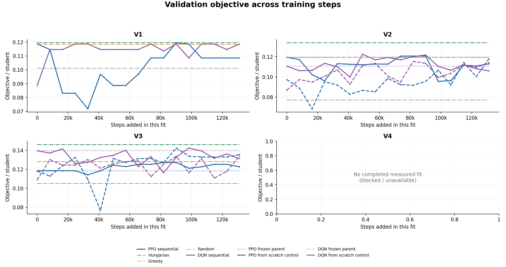
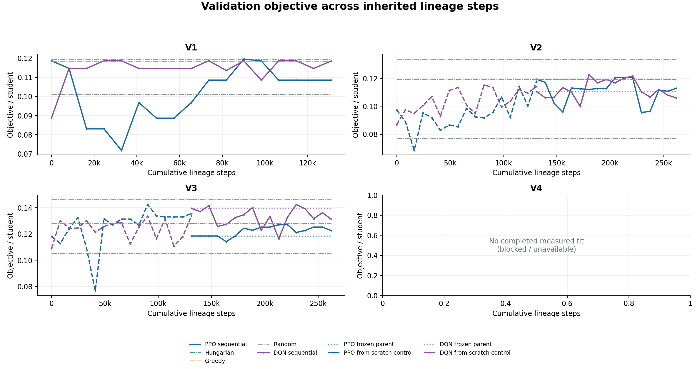
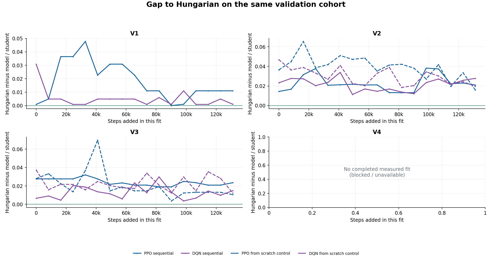
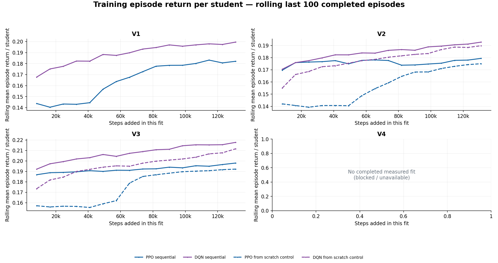
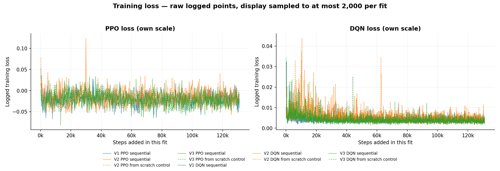
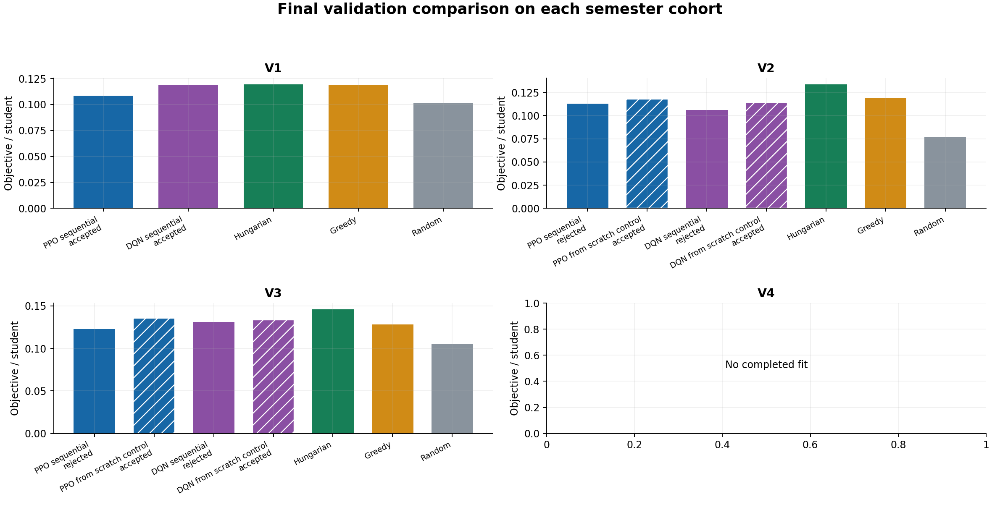
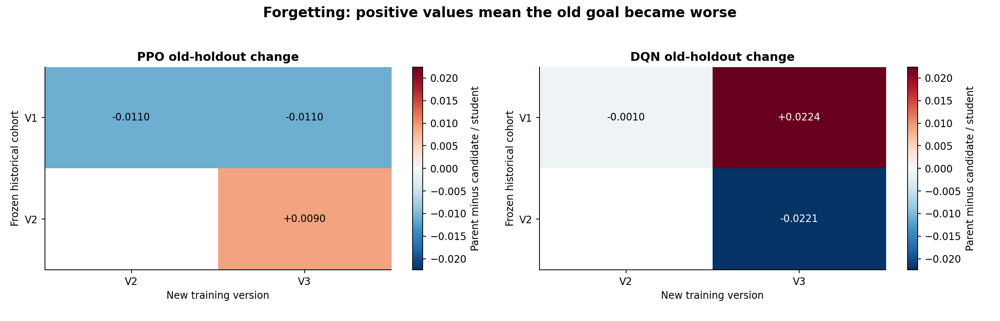
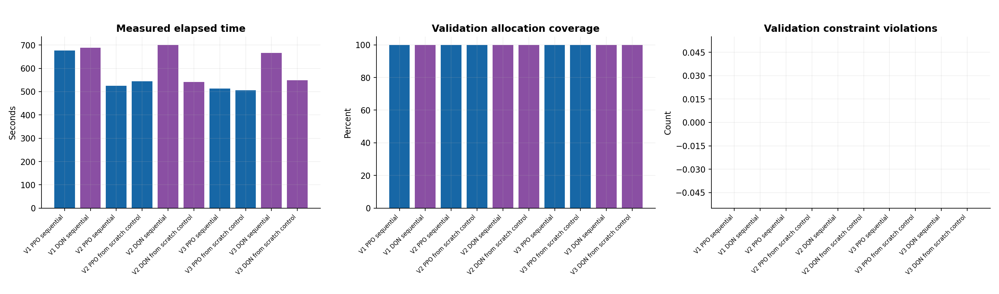
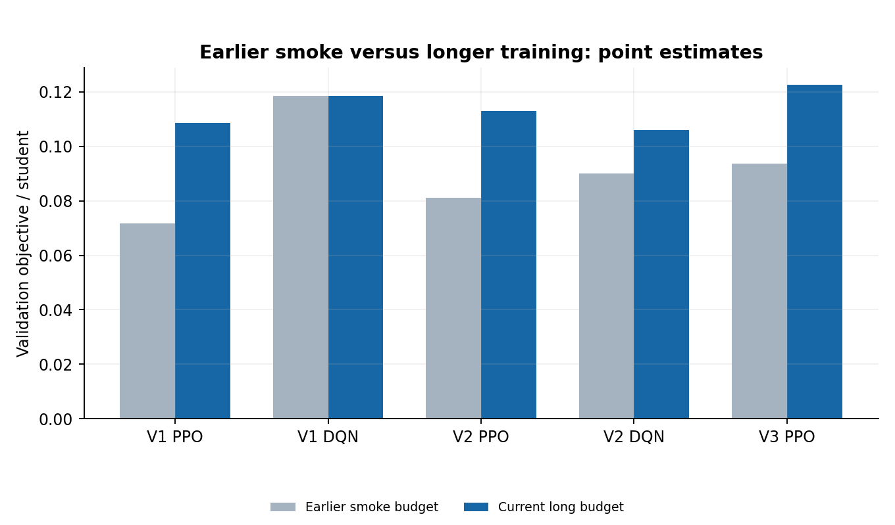
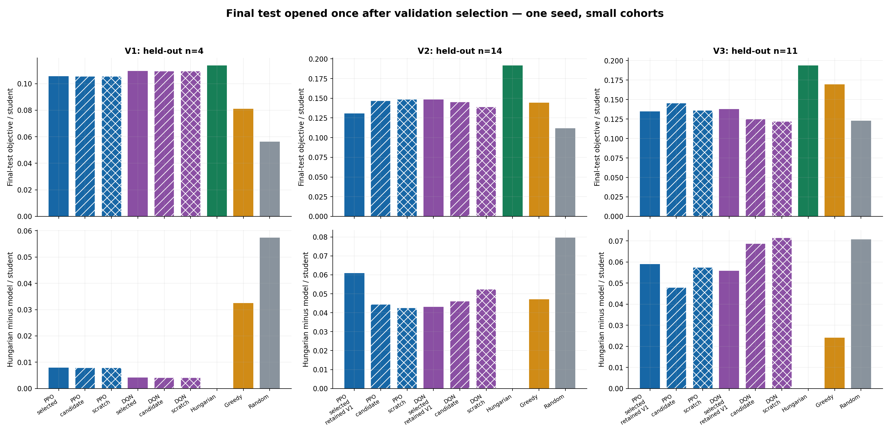

# Báo cáo RL hai cấp

## Kết quả chính

**Đã hoàn tất 10 lượt fit, mỗi lượt 131.072 bước, tổng 1.310.720 bước thực tế; 170 mốc đo và 10 biểu đồ PNG/SVG. 101 tests đạt.**

V1 của PPO/DQN được chấp nhận làm checkpoint nghiên cứu. Candidate V2 và V3 của cả hai learner bị từ chối theo tiêu chí đã chốt; hệ thống giữ đúng trọng số V1 và vẫn cho kỳ sau học tiếp qua sổ kế thừa. Không dùng trọng số đã bị từ chối và không train lại lineage từ đầu.

Kết quả chưa chứng minh RL hai cấp tốt hơn Hungarian hoặc train từ đầu. Điểm lên/xuống theo step, và thêm bước có thể làm giảm chất lượng trên cohort mới hoặc cũ. DQN được giữ có điểm test cao hơn PPO được giữ trên cả ba cohort, nhưng cả hai vẫn thấp hơn Hungarian. Một seed và holdout nhỏ chưa đủ kết luận tổng quát.

Code hỗ trợ vòng preference/eligibility/score trong kỳ và kế thừa/rollback liên kỳ; cơ chế này đã kiểm tra bằng fixture tổng hợp. **Dữ liệu nghiên cứu hiện chỉ có nguồn ban đầu mỗi kỳ, chưa có phản hồi người thật trong kỳ; không biến các mốc step thành vòng feedback giả.** Model phục vụ hiện tại chưa được thay.


## Thiết kế thí nghiệm và mốc chốt protocol

Mục tiêu: chạy mô hình thật trên dữ liệu mới, đo khả năng kế thừa giữa các kỳ và so sánh diễn biến theo số bước. Dùng một báo cáo này xuyên suốt quá trình; các JSON/checkpoint/biểu đồ là artifact máy đọc.

- Branch `susois/nested-rl`; nguồn mới trong `data_rebuild/nested_rl_20261028/20261027T190955Z`.
- Giữ nguyên raw/gold/model cũ và đợt smoke 1.024 bước. Dùng lại đúng suite đã đóng băng của nguồn mới để so sánh cùng dữ liệu/encoder/split.
- Ngân sách cố định **131.072 bước cho mỗi lần fit**, seed 42; đo validation mỗi **8.192 bước**, cộng mốc ban đầu và cuối.
- PPO và DQN chạy trong hai process độc lập; mỗi process một CPU thread để không chia sẻ RNG.
- Kế thừa checkpoint được chấp nhận gần nhất. Khi candidate bị từ chối, sổ kế thừa ghi phiên bản dữ liệu hiện hành trỏ về trọng số cũ; kỳ sau tiếp tục từ trọng số đó, không dùng candidate bị từ chối hoặc khởi tạo lại model.
- Chọn checkpoint cuối ngân sách, không chọn mốc có validation đẹp nhất. Cho phép chấp nhận không suy giảm; chỉ gọi cải thiện khi delta > 0. Không cho giảm mục tiêu mới hoặc holdout cũ.
- Đối chứng cùng ngân sách: train từ đầu V2 và V3, dùng cùng input/seed; ghi rõ đây là đối chứng, không phải continual RL.
- Vòng phản hồi trong cùng kỳ chỉ mở khi có feedback thật đã được áp dụng vào preference/ràng buộc. Hiện chưa có; các mốc step là tối ưu tiếp, không phải bốn tín hiệu giả.
- Curve chỉ dùng train/validation. Final test mở một lần sau khi hoàn tất training và đóng băng lựa chọn; không retune dựa vào test.
- Kết quả một seed là điểm đo, không có khoảng tin cậy nhiều seed. Nhiều step là lặp lại cohort nhỏ, không phải thêm 131 nghìn sinh viên.

## Dữ liệu và phạm vi kết luận

Học kỳ lấy ngày ở trang 1–2: tháng 1–5 là kỳ `.2` của năm học trước; 6–8 là `.3`; 9–12 là `.1` của năm đó. Hè `2024.3` gộp vào training `2025.1`. Nguồn mới gồm 38 hồ sơ giảng viên, 413 mục công bố theo hồ sơ và 218 tài liệu sinh viên đọc lại từ bytes gốc; không ghi đè dữ liệu cũ.

Train/validation/test lần lượt V1=24/4/4, V2=56/9/14, V3=43/7/11. V4 chỉ một hồ sơ nên chưa đủ chia split. Encoder chỉ fit train V1 và đóng băng qua kỳ; thông tin năng lực đầu kỳ, nguyện vọng và outcome thật chưa có.

Đây là mô phỏng hồi cứu bằng tiêu đề khóa luận và trích dẫn công bố, chưa chứng minh thông tin có sẵn ở thời điểm phân công trong lịch sử. Quota được dựng riêng theo split; validation nhỏ chỉ có quota dương cho 4/9/7 giảng viên đầu registry, không kiểm chứng tổng quát hóa trên mọi giảng viên. Mask/ràng buộc cứng bảo đảm phần lớn tính hợp lệ; zero violations không tự chứng minh model học fairness.

Hungarian giải tối ưu chính objective tuyến tính tĩnh đang dùng. RL có thể thu hẹp khoảng cách hoặc học policy suy luận nhanh, không thể vượt nghiệm tối ưu trên cùng bài toán nếu mọi phép đo đúng. Không gọi điểm proxy là accuracy học vụ.

## Mô hình và hai cấp cập nhật

State có 343 chiều, gồm 9 nhóm thông tin cho registry 38 giảng viên và một tỷ lệ sinh viên còn lại; action là chọn giảng viên còn khả thi. Model dùng MLP 128×128. PPO: rollout 256, batch 64, 5 epochs/update, learning rate 0,0003; DQN: replay 10.000, batch 64, cập nhật mỗi 4 bước, target mỗi 200 bước, learning rate 0,001. Gamma 0,99. DQN dùng epsilon 0,2 xuống 0,05 trong mỗi lần fit. Không đổi cấu hình sau khi nhìn điểm test.

Cấp ngoài kế thừa policy, optimizer và counter giữa các kỳ; PPO lấy rollout mới, DQN loại replay khi ngữ nghĩa snapshot thay đổi. Cấp trong hỗ trợ dữ liệu preference/eligibility/score có nguồn thật, hash và thay đổi `old/new` khớp input. Không chấp nhận chỉ thêm một file “feedback” mà input không đổi.

Sổ giữ model phân biệt **nguồn trọng số** với **bối cảnh logic hiện hành**: nếu V2 bị từ chối và vẫn dùng V1 thì V3 nhận đúng trọng số/optimizer/counter V1, còn lịch chuyển kỳ là V2→V3. Số bước đã chi cho candidate V2 thất bại được đếm vào chi phí thí nghiệm, không cộng giả vào tuổi của checkpoint được giữ. Luồng này được chốt trước kết quả cuối V2; không thay learning rate, ngân sách hoặc gate sau khi xem kết quả. Pha train đầu và pha tiếp tục có manifest riêng, chưa mở test ở giữa.

Đã chạy test tích hợp **bốn vòng trong kỳ rồi chuyển kỳ** trên fixture tổng hợp: khởi tạo → preference → giảng viên sửa eligibility → điều phối sửa score → kỳ tiếp theo kế thừa vòng 4. Test kiểm tra trọng số, counter, replay, hash, holdout và parity. Đây là bằng chứng kiểm tra phần mềm, không phải dữ liệu phản hồi thật và không nằm trong các đường cong nghiên cứu.

Mỗi điểm return lấy trung bình tối đa 100 episode train vừa hoàn tất, chia theo số sinh viên; loss PPO/DQN có thang riêng. Return có completion bonus và shaping, không đồng nhất objective validation. Các biểu đồ dùng điểm thực, không nội suy điểm thiếu hoặc tự thêm confidence interval.

## Kết quả validation cuối ngân sách

Mỗi parent được chấm lại trên **cùng bối cảnh mới** với candidate. Không lấy điểm V1 trên cohort V1 trừ điểm V2 trên cohort V2. Đối chứng khởi tạo policy từ đầu nhưng dùng cùng encoder/suite đóng băng; V1 là bootstrap dùng chung, không có một lượt đối chứng V1 thứ hai.

| Learner | Phiên bản | Parent trên kỳ mới | Candidate 131k | Từ đầu 131k | Hungarian | Gate |
| --- | --- | --- | --- | --- | --- | --- |
| PPO | V1 | — | 0.108544 | 0.108544 | 0.119531 | accepted |
| PPO | V2 | 0.119388 | 0.112900 | 0.117858 | 0.133791 | rejected |
| PPO | V3 | 0.118495 | 0.122640 | 0.135579 | 0.146125 | rejected |
| DQN | V1 | — | 0.118531 | 0.118531 | 0.119531 | accepted |
| DQN | V2 | 0.110605 | 0.106005 | 0.114151 | 0.133791 | rejected |
| DQN | V3 | 0.139567 | 0.131340 | 0.133837 | 0.146125 | rejected |

Lý do từ chối cụ thể:

- **PPO V2:** giảm 0,006488 trên bối cảnh mới, dù điểm V1 cũ tăng.
- **DQN V2:** giảm 0,004600 trên bối cảnh mới; không đạt điều kiện nhận model mới.
- **PPO V3:** tăng 0,004145 trên bối cảnh V3, nhưng giảm 0,008966 trên holdout V2; bị từ chối để giữ mục tiêu cũ.
- **DQN V3:** giảm 0,008227 trên bối cảnh mới và giảm 0,022441 trên holdout V1.

V3 thực sự đã được train từ trọng số V1 được giữ qua logical V2. Đó là tiếp tục policy được chấp nhận gần nhất, không phải dùng candidate V2 thất bại hoặc reset ngẫu nhiên. Sổ giữ model cũng hỗ trợ trường hợp vòng trong kỳ bị từ chối: bối cảnh/tín hiệu vẫn cập nhật, trọng số chỉ lấy từ bản đã chấp nhận.

## Bước training và chi phí bị loại

| Lượt | Counter trước fit | Bước thêm | Counter candidate cuối | Checkpoint được giữ |
| --- | --- | --- | --- | --- |
| V1, mỗi learner | 0 | 131.072 | 131.072 | V1 |
| V2 kế thừa, mỗi learner | 131.072 | 131.072 | 262.144 | V1: vẫn 131.072 bước |
| V3 qua sổ giữ model, mỗi learner | 131.072 | 131.072 | 262.144 | V1: vẫn 131.072 bước |
| V2/V3 từ đầu, mỗi learner | 0 | 131.072 | 131.072 | Đối chứng độc lập |

6 lượt kế thừa/bootstrap dùng 786.432 bước; 4 đối chứng độc lập dùng 524.288 bước. Tổng 1.310.720. Trong nhánh kế thừa, 524.288 bước đã chi cho bốn candidate không được nhận; chi phí này không được cộng giả vào tuổi checkpoint V1.

Đối chứng bằng nhau về **ngân sách bổ sung**, không bằng tổng chi phí lịch sử: warm start đã có 131.072 bước pretrain; scratch policy chưa có. Cả hai dùng chung encoder đã fit ở train V1. Số bước là số transition mô phỏng, không phải số sinh viên mới.

## Final test mở một lần sau khi đóng băng lựa chọn

Test có 4/14/11 hồ sơ ở V1/V2/V3. Điểm là objective tài liệu hồi cứu trên mỗi sinh viên, **không phải accuracy, điểm khóa luận hoặc mức hài lòng**. Bảng sau là model được chọn theo validation trước khi mở test.

| Test | n | PPO được giữ | DQN được giữ | Hungarian | Greedy | Random seed42 |
| --- | --- | --- | --- | --- | --- | --- |
| V1 | 4 | 0.105690 | 0.109519 | 0.113652 | 0.081137 | 0.056308 |
| V2 | 14 | 0.130587 | 0.148416 | 0.191483 | 0.144405 | 0.111890 |
| V3 | 11 | 0.134744 | 0.137924 | 0.193676 | 0.169539 | 0.122965 |

Cả hai learner đều dùng checkpoint V1 tại ba bối cảnh test vì candidate V2/V3 không qua gate. DQN được giữ hơn Greedy ở V1/V2 nhưng thấp hơn Greedy ở V3; không có chiến thắng đồng đều trước các baseline.

| Learner | Test | Warm candidate | Scratch candidate | Warm − scratch |
| --- | --- | --- | --- | --- |
| PPO | V2 | 0.147060 | 0.148835 | -0.001775 |
| PPO | V3 | 0.145719 | 0.136273 | +0.009446 |
| DQN | V2 | 0.145319 | 0.139065 | +0.006255 |
| DQN | V3 | 0.124945 | 0.122175 | +0.002769 |

Ba trong bốn cặp warm/scratch có điểm test nghiêng về warm, một cặp nghiêng về scratch. Đây là điểm đo một seed, chưa chứng minh ưu thế thống kê. Candidate PPO V2/V3 có thể cao hơn model được giữ trên test; **không đổi lựa chọn sau khi thấy điều này**. Nếu chọn lại dựa trên test thì test không còn độc lập.

Lượt mở test ghi `selection_changed=false`, `learning_performed=false`, 14 cặp checkpoint–holdout duy nhất. Một checkpoint có thể xuất hiện dưới nhiều vai trò trên biểu đồ, nhưng dùng lại kết quả cache; không coi các cột trùng checkpoint là các mẫu độc lập.

## Biểu đồ

Đường liền: nhánh kế thừa; đường đứt: policy train từ đầu; đường chấm: parent cố định. Mỗi mốc validation cách 8.192 bước, điểm cuối sau update cuối ngân sách. Không chọn checkpoint tốt nhất giữa chừng. Các panel V4 trống có chủ ý vì không đủ dữ liệu, không phải đã train rồi bị mất hình.

### Điểm validation theo bước thêm

Các đường lên/xuống là điểm thực trên cùng cohort. Cần so từng panel, không xếp hạng các năm bằng raw score giữa cohort khác nhau.



[Bản SVG để phóng lớn](assets/rl_2_cap/validation_steps.svg)

### Bộ đếm bước của lineage

V3 bắt đầu ở 131.072 vì giữ trọng số V1 qua V2; không bắt đầu ở 262.144 của candidate V2 đã bị loại.



[Bản SVG để phóng lớn](assets/rl_2_cap/validation_cumulative_steps.svg)

### Khoảng cách tới Hungarian

Càng gần 0 càng tốt. Đây là upper bound của objective tuyến tính đang chấm; không phải xác suất phân công đúng.



[Bản SVG để phóng lớn](assets/rl_2_cap/hungarian_regret.svg)

### Return trên train

Rolling mean tối đa 100 episode, chia theo số sinh viên; có completion bonus/shaping. Return train không đồng nhất objective validation.



[Bản SVG để phóng lớn](assets/rl_2_cap/training_return.svg)

### Loss của PPO và DQN

Hai trục thang riêng; raw loss chỉ lấy mẫu hiển thị khi quá dày. Không so trực tiếp độ lớn loss PPO với DQN hoặc dùng loss giảm để kết luận test tăng.



[Bản SVG để phóng lớn](assets/rl_2_cap/training_loss.svg)

### So sánh cuối 131.072 bước trên validation

Mỗi cột là checkpoint cuối ngân sách, gồm cả candidate bị từ chối. Accepted bootstrap không có nghĩa vượt Hungarian.



[Bản SVG để phóng lớn](assets/rl_2_cap/final_comparison.svg)

### Giữ chất lượng trên bối cảnh cũ

Đỏ: giảm so với policy thực sự được giữ; xanh: tăng. V2 chưa từng được nhận vào trọng số nhưng vẫn là bối cảnh cũ cần kiểm tra, không gọi nó là kiến thức đã học thành công.



[Bản SVG để phóng lớn](assets/rl_2_cap/forgetting_heatmap.svg)

### Thời gian và tính khả thi

Chạy hai process trên máy hiện tại; thời gian không phải benchmark tốc độ cô lập. Coverage/zero violations chủ yếu phản ánh hard mask và quota, không phải hiệu quả học vụ.



[Bản SVG để phóng lớn](assets/rl_2_cap/runtime_constraints.svg)

### Lượt smoke 1.024 bước và lượt 131.072 bước

Dùng cùng validation suite. Quỹ đạo parent cũng thay đổi nên không quy toàn bộ chênh lệch cho số bước.



[Bản SVG để phóng lớn](assets/rl_2_cap/smoke_vs_long.svg)

### Kết quả final test sau lựa chọn đóng băng

Phân biệt model được giữ, candidate và đối chứng. Biểu đồ này không xuất hiện trong vòng training hoặc chọn checkpoint.



[Bản SVG để phóng lớn](assets/rl_2_cap/final_test_comparison.svg)

## Kết luận thực nghiệm và phần còn thiếu

- Đã chứng minh phần mềm kế thừa được trọng số/optimizer/counter, giữ policy cũ qua candidate thất bại, tách holdout và tạo được kết quả >100k bước có kiểm chứng.
- Chưa chứng minh continual RL cải thiện đều theo kỳ. Tăng step không bảo đảm tăng validation/test; loss/return train không thay thế đánh giá ngoài train.
- Dữ liệu ít, validation rất nhỏ, quota dựng theo split và policy không thấy toàn bộ ma trận điểm tương lai như Hungarian. Các yếu tố này hạn chế khả năng tổng quát hóa; chưa có ablation đủ để quy nguyên nhân cho riêng yếu tố nào.
- Gamma 0,99 và shaping nằm trong reward học; objective báo cáo là điểm không chiết khấu. Hai đại lượng không đồng nhất. Một đoạn validation phẳng trên vài sinh viên không chứng minh hội tụ tham số.
- Chưa có feedback sinh viên/giảng viên/điều phối hoặc outcome có timestamp để chạy R2–R4 thật. V4 chỉ một hồ sơ; không tạo split hay feedback giả. Năm/tháng thiếu, DOCX chưa render trang và bìa scan vẫn có trạng thái thiếu riêng.
- Muốn kết luận tác dụng của RL trong kỳ cần dữ liệu phản hồi thật; muốn đánh giá mạnh hơn cần cohort/holdout lớn hơn, nhiều seed và protocol mới chốt trước test. Không retune trên final test vừa mở.

## Kiểm chứng và artifact

| Kiểm tra | Kết quả |
| --- | --- |
| Lượt fit / số bước | 10 / 1.310.720; mỗi lượt đủ 131.072 |
| Điểm đo validation | 170; 17 mốc/lượt |
| Warm start / lưu-nạp-inference | 4/4 trọng số khởi đầu trùng parent; 10/10 reload/inference parity đạt |
| Sổ giữ model | 4 ledger đã verify; không đổi native checkpoint cũ |
| Source native PPO/DQN/environment | Hash giống nhau qua cả hai pha; chỉ engine/orchestration thêm retention |
| Regression tests | 101 passed; cảnh báo deprecation Gym wrapper có sẵn |
| Dữ liệu cũ | 225 file không đổi size/mtime; hash hai CSV gold khớp |
| Model phục vụ | Không promote; trạng thái nghiên cứu |
| Báo cáo người đọc | Một file này; JSON/checkpoint/PNG/SVG là artifact hỗ trợ |

Thư mục thí nghiệm: `data_rebuild/nested_rl_20261028/20261027T190955Z/long_research/`.

- `index.base.json`, `manifest.base.json`: pha đầu giữ nguyên.
- `retention_protocol.json`: chốt trước terminal V2, được kiểm tra timestamp; cùng budget/gate ở cả hai pha.
- `index.json`, `manifest.json`, `continuation/`: kết quả tổng hợp sau luồng retention.
- `rounds/{ppo,dqn}/{V1,V2,V3}/`: sáu candidate kế thừa/bootstrap, gồm training/inference checkpoint, input, curve, quyết định và manifest.
- `controls/from_scratch/{ppo,dqn}/{V2,V3}/`: bốn đối chứng độc lập.
- `retention/`: liên kết phiên bản logic với checkpoint thực sự được giữ; không copy hoặc đổi nhãn trọng số thành accepted giả.
- `final_test.json`: kết quả test mở một lần, selection không đổi. `index.test_evaluated=false` là cờ của training index đã đóng băng; trạng thái mở test nằm trong file riêng này.
- `experiment_audit.json`: tổng kiểm chứng nguồn, step, parity, ảnh và tính nguyên vẹn dữ liệu cũ.
- `docs/assets/rl_2_cap/`: 10 PNG + 10 SVG và chỉ mục hình, chỉ chứa số liệu tổng hợp.

Các entrypoint đã thực thi: `scripts/run_fresh_research.py`, `scripts/continue_retained_research.py`, `scripts/evaluate_nested_final.py`, `scripts/plot_nested_training.py`. Khi lặp thí nghiệm phải dùng output mới, ghi protocol trước terminal V2 và giữ test đóng đến sau cả hai pha. Lệnh mở test từ chối chạy lại trên cùng output.

Có thể kiểm tra/replot mà không train hoặc mở test lại:

```powershell
python -X utf8 scripts/train_nested_rl.py --verify data_rebuild/nested_rl_20261028/20261027T190955Z/long_research/rounds/ppo/V1
python -X utf8 scripts/plot_nested_training.py --run data_rebuild/nested_rl_20261028/20261027T190955Z/long_research --output docs/assets/rl_2_cap --reference data_rebuild/nested_rl_20261028/20261027T190955Z/research
```

Chốt báo cáo: 28/10/2026 03:51 (Asia/Saigon). Dữ liệu cá nhân và checkpoint nằm trong thư mục private bị Git ignore.
