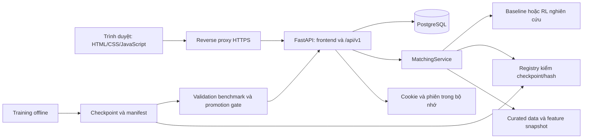

# UniMatch/KLTN — kiến trúc, mã nguồn và thuật toán

Cập nhật: 15/10/2026. Tài liệu này mô tả implementation trong repository `KLTN`, cách vận hành web và giới hạn của kết quả nghiên cứu. Kết quả kiểm chứng của đợt hoàn thiện được ghi riêng tại [completion_validation.md](completion_validation.md). Hướng dẫn triển khai nằm tại [deployment.md](deployment.md).

## 1. Mục tiêu và phạm vi

Hệ thống hỗ trợ ghép sinh viên với giảng viên dựa trên tương thích văn bản và hạn mức hướng dẫn. Người dùng đăng nhập, chọn dữ liệu/phương pháp, chạy phân bổ, xem từng quyết định trên mô phỏng, xem benchmark và gửi phản hồi. Khuyến nghị theo tiêu đề là một luồng riêng: trả top-k giảng viên, không thay thế phân bổ có ràng buộc.

Source hiện có gồm ba baseline, sáu thuật toán RL cho action rời rạc, quy trình chuẩn bị dữ liệu, benchmark/promotion, API, frontend và storage. Có code kiểm tra tính tương thích của TQC; TQC bị chặn vì action liên tục không phù hợp với môi trường hiện tại. Chưa có model supervised non-RL được huấn luyện; giao diện/API phải báo unavailable thay vì giả lập kết quả.

## 2. Kiến trúc và đường đi dữ liệu



FE và API dùng cùng origin. `fetch` dùng đường dẫn `/api/v1/...`, do đó triển khai một domain không cần cấu hình URL backend trong bundle hay thêm CORS tùy tiện. FastAPI phục vụ `frontend/dist`; khi chạy source chưa build, có fallback về `frontend`.

Khi khởi động, `MatchingService` đọc dữ liệu, kiểm hash/dimension/order/split và nguồn hồ sơ GV. Artifact thiếu/sai làm service unavailable; health vẫn trả trạng thái degraded và `data_loaded=false`. PostgreSQL được khởi tạo trong lifespan; lỗi kết nối DB phải được giải quyết trước khi ứng dụng có thể phục vụ bình thường. Không được coi HTTP 200 của health là bằng chứng mọi điều kiện nghiên cứu đã đạt.

Phiên đăng nhập hiện nằm trong bộ nhớ một process. Khởi động lại sẽ đăng xuất mọi người; không chạy nhiều worker/replica với session store này. Cơ chế này phục vụ một dashboard có tài khoản cấu hình qua môi trường; chưa phải hệ thống tài khoản sinh viên/GV nhiều vai trò.

## 3. Bản đồ mã nguồn

| Đường dẫn | Trách nhiệm |
|---|---|
| `run_dashboard.py` | Launcher Uvicorn, kiểm credential, demo chỉ bind loopback |
| `backend/app/main.py` | HTTP routes, auth, Origin, health, trả lỗi, static FE |
| `backend/app/schemas.py` | Validate request bằng Pydantic, từ chối field thừa |
| `backend/app/cohorts.py` | Đọc Excel sinh viên, kiểm input, chọn GV và phân bổ cân bằng theo đợt |
| `backend/app/storage.py` | Persistence PostgreSQL và SQLite cho local |
| `database/schema.sql`, `schema.sqlite.sql` | Schema và ràng buộc/index cho hai database |
| `frontend/index.html`, `style.css` | Cấu trúc, giao diện v1 và responsive |
| `frontend/app.js` | Auth, catalog, lựa chọn mô hình, gọi API, results |
| `frontend/student-cohorts.js` | Helper quota, tìm GV và trạng thái hợp lệ của luồng nhập SV |
| `frontend/visualization.js` | Canvas, tọa độ 3D, event replay và thao tác camera |
| `src/data_pipeline/` | Crawl, extract, identity, chất lượng và split |
| `src/features/` | TF-IDF, cosine, manifest và integrity nguồn GV |
| `src/domain/` | Thực thể và ràng buộc phân bổ |
| `src/baselines/` | Random, Greedy, Hungarian |
| `src/environment/` | Gymnasium MDP, reward, action mask |
| `src/rl/` | Trainer, cấu hình, provenance, checkpoint/resume |
| `src/rlhf/` | Schema preference, thu thập và gate readiness |
| `src/evaluation/` | Metrics, benchmark, promotion |
| `src/serving/` | Inference, catalog, registry, replay có provenance |
| `scripts/` | CLI chuẩn bị dữ liệu, training, benchmark, smoke, release |
| `tests/` | Regression/contracts theo từng subsystem |
| `baocao/` | Bản thảo khóa luận 12 chương và kịch bản bảo vệ |

Các thư mục `data/` và `outputs/` là dữ liệu/artifact riêng tư, không phải source cần public. Clone Git sạch không tự có bộ dữ liệu và checkpoint. Docker image cũng không đóng gói chúng; phải mount bộ artifact đã kiểm chứng.

## 4. Hợp đồng dữ liệu

Snapshot hiện hành có **215 sinh viên/đề tài và 38 giảng viên**, chia train/validation/test/future là **154/20/21/20**. Preflight kiểm chứng lại số lượng và mapping, không suy ra từ tên file.

Các artifact chính:

- `data/curated/theses.json`, `advisors.json`: thực thể và nội dung nguồn.
- `data/curated/split_indices.json`: index và thứ tự student ID cho từng split.
- `data/curated/serving_contract.json`: hash/order/count dùng cho serving.
- `data/curated/quality_report_v2.json`: trạng thái và hash các input được đóng băng.
- `data/features/compatibility_matrix_v2.npy`: ma trận 215 × 38, đọc với `allow_pickle=False`.
- `data/features/feature_manifest_v2.json`: method, shape và hash provenance.

Web chỉ mở `real-train` và `real-validation`. `real-test` bị khóa để tránh dùng final holdout cho lựa chọn thuật toán. Tên/mã hiển thị dùng ID giả danh như `SV-TRAIN-001`, `GV-001`; không công bố tên và nguồn riêng tư qua catalog/dataset.

Hạn mức hiện dùng `ceil(số sinh viên / số giảng viên)` cho từng GV trong split. Đây là giả định thực nghiệm, chưa phải quota do nhà trường ban hành. Việc lọc 220 xuống 215 giữ feature snapshot đã đóng băng; một số văn bản train bị loại vẫn ảnh hưởng vocabulary cũ. Đây là giới hạn cần công bố, không tự sửa snapshot giữa một protocol thực nghiệm đang dùng.

## 5. Biểu diễn và bài toán tối ưu

`FeatureBuilder` dùng `TfidfVectorizer(lowercase=True, ngram_range=(1,2), min_df=1, norm='l2')`. Vocabulary fit từ train và hồ sơ GV, không fit văn bản validation/test. Tương thích là cosine giữa vector đề tài và vector hồ sơ GV. Nếu caller cung cấp cả hai ma trận dense, implementation có thể lấy trung bình điểm TF-IDF và dense; runtime hiện tại không mặc nhiên có embedding service.

Với điểm `s[i,j]`, biến nhị phân `x[i,j]` và hạn mức `q[j]`, bài toán là:

```text
maximize sum(i,j) s[i,j] * x[i,j]
subject to sum(j) x[i,j] = 1             với mỗi sinh viên i
           sum(i) x[i,j] <= q[j]         với mỗi giảng viên j
           x[i,j] in {0,1}
```

Điểm tương thích không phải xác suất được GV nhận hướng dẫn. Khuyến nghị nội dung không xác nhận chuyên môn, lịch trống hay đồng ý của giảng viên.

## 6. Thuật toán đầy đủ trong source

| Thuật toán | Implementation | Hành vi và giới hạn |
|---|---|---|
| Random | `src/baselines/random.py` | Rút ngẫu nhiên không hoàn lại từ các slot capacity; seed tái lập; số slot của GV ảnh hưởng xác suất |
| Greedy | `src/baselines/greedy.py` | Duyệt sinh viên theo thứ tự cố định, chọn điểm cao nhất trong GV còn chỗ; nhanh nhưng phụ thuộc thứ tự |
| Hungarian | `src/baselines/hungarian.py` | Nhân bản mỗi GV thành các slot, dùng `scipy.optimize.linear_sum_assignment` tối đa tổng điểm; không tối ưu fairness như một mục tiêu riêng |
| MaskablePPO | `src/rl/ppo.py` | PPO với action mask GV còn quota; MLP `[16]`, rollout 8, batch 4, một epoch mỗi update |
| DQN | `src/rl/dqn.py` | Q-learning với replay; MLP `[16]`, buffer 64, batch 8, train mỗi bước; không có mask native |
| QRDQN | `src/rl/qrdqn.py` | Distributional Q-learning, 8 quantile, buffer 64, batch 8; không có mask native |
| TRPO | `src/rl/trpo.py` | Update policy theo trust region, MLP `[16]`, rollout 4, batch 2 |
| ARS | `src/rl/ars.py` | Random search trên LinearPolicy, `n_delta=2`, `n_top=1` |
| RecurrentPPO | `src/rl/recurrent_ppo.py` | PPO LSTM, hidden 16, rollout 4, batch 2, truyền recurrent state và episode_start |
| TQC | `src/rl/tqc.py` | Kiểm tra rồi từ chối Discrete action; không tự làm tròn action liên tục thành ID GV |

Các hyperparameter là cấu hình nhỏ đang có trong code; chưa có bằng chứng đây là cấu hình tối ưu cho bài toán. `PPO` trong dự án được triển khai dưới dạng `MaskablePPO`; không khẳng định có thêm một pipeline PPO chuẩn độc lập.

### Môi trường MDP

Một bước xử lý sinh viên tiếp theo trong thứ tự đã đóng băng. Action là chỉ số GV `0..37`. Observation gồm ba vector: điểm tương thích của sinh viên hiện tại, tỉ lệ chỗ còn lại, tỉ lệ tải hiện tại. Tổng chiều là `3 × 38 = 114`.

```text
reward = compatibility
       + 0.15 * (variance(load_before) - variance(load_after))
       - 2.0 * invalid_action
```

Action không hợp lệ không thay đổi tải và không chuyển sinh viên. Training có `TimeLimit` tối đa `4 × số sinh viên` để tránh episode bị kẹt. Serving/replay có vòng lặp hữu hạn; khi policy chọn GV hết chỗ, ghi event invalid rồi áp dụng Greedy fallback và ghi event riêng. Kết quả đã repair không được mô tả là chất lượng policy thô.

### Checkpoint và promotion

Manifest gắn thuật toán, seed, ngân sách yêu cầu/thực tế, thư viện, hash dữ liệu/feature/split/capacity policy, scope và checkpoint SHA-256. Registry kiểm nội dung ZIP và không gian observation/action trước khi load. Toy model `[6]`/2 action chỉ dùng sample; không dùng cho dữ liệu 38 GV. Chỉ load checkpoint từ nguồn tin cậy do administrator quản lý; hash không biến file model không rõ nguồn thành an toàn.

Gate promotion mặc định yêu cầu đủ năm seed `42,123,456,789,1024`, ít nhất 2.000.000 bước/seed, đúng provenance train và validation, coverage 1, không invalid/quota/fallback và optimality ratio ít nhất 0,88 so với Hungarian. Thỏa số bước riêng lẻ không đủ để promote. Registry hiện luôn gắn `promoted=false` cho replay nghiên cứu; approval production là bước quản trị chưa triển khai đầy đủ.

`src/rlhf/` hiện kiểm schema/provenance/consent và readiness của preference: ít nhất 100 record thật, không trùng ID, có multi-review evidence, agreement ít nhất 0,7. Chưa có reward model được học từ nhãn chuyên gia đủ điều kiện; feedback boolean trên web không tự trở thành nhãn preference A/B.

## 7. API và contract HTTP

| Method/path | Auth | Input/đầu ra |
|---|---|---|
| `GET /health`, `/api/v1/health` | Không | `status`, `data_loaded`, `quality_ready`, số GV/model |
| `POST /api/v1/auth/login` | Không | `{email,password}`, tạo cookie HttpOnly |
| `GET /api/v1/auth/session` | Không | `{authenticated,user}` |
| `POST /api/v1/auth/logout` | Không | Thu hồi session, xóa cookie |
| `GET /api/v1/catalog` | Có | Dataset, checkpoint, mode và quality |
| `GET /api/v1/datasets/{name}` | Có | Scores, capacity, alias ID và provenance |
| `POST /api/v1/simulate` | Có | Assignment, event trace, metrics, model/data version |
| `POST /api/v1/allocate` | Có | Cùng logic phân bổ; DB ghi endpoint riêng |
| `POST /api/v1/recommend` | Có | `{title,top_k}`, top-k tương thích và evidence reference |
| `GET /api/v1/results/summary` | Có | Benchmark summary/rows gọn, kiểm provenance |
| `GET /api/v1/benchmark/summary` | Có | Alias của results summary |
| `POST /api/v1/feedback` | Có | `{mode,algorithm,helpful}`, lưu phản hồi |
| `GET /api/v1/student-cohorts/advisors` | Có | Danh sách ID/tên GV thật để chọn tham gia |
| `GET /api/v1/student-cohorts/template` | Có | Excel khảo sát 26 cột, không cần đề tài, kèm danh mục kỹ năng |
| `POST /api/v1/student-cohorts/preview` | Có | Body binary `.xlsx`, kiểm dữ liệu và xem trước sinh viên |
| `POST /api/v1/student-cohorts/allocate?advisor_ids=...` | Có | Body binary `.xlsx`, Hungarian với quota cân bằng trên GV được chọn |

Request ví dụ sau đăng nhập:

```json
{"mode":"semantic","algorithm":"hungarian","dataset":"real-train","seed":42}
```

Response nghiệp vụ dùng `{"status":"success","data":...}`. Lỗi dùng `{"status":"error","error":{"code":...,"message":...}}`. Session/health có cấu trúc riêng như bảng. Mọi request ghi cần header `Origin` hợp lệ; cookie phải được gửi lại. `401` là chưa đăng nhập, `403` là Origin bị từ chối, `422` là sai schema, `409 benchmark_unverified` là benchmark không khớp snapshot. Lỗi nội bộ không trả stack trace/credential cho client.

Ví dụ khuyến nghị: `{"title":"Phát hiện vật thể trong ảnh giao thông","top_k":3}`. API chưa có quản trị CRUD dataset, đăng ký tài khoản, duyệt GV hay upload checkpoint từ trình duyệt; các thao tác này hiện thuộc pipeline offline.

Luồng Excel dùng trang `#/students`, contract khảo sát tại `configs/student_survey_schema.json` (v2, sheet KhaoSat; mẫu v1 SinhVien vẫn hỗ trợ) và workbook `assets/student-skills-template.xlsx`. Đây là nhóm đầu vào độc lập, không sửa curated snapshot. Với N SV/M GV đã chọn, quota là `N//M` hoặc `N//M+1` và tổng bằng N; Hungarian lấp đúng các slot đó. Ví dụ 38/4 tạo 10–10–9–9. Result và dữ liệu cohort được lưu trong `simulation_runs` với snapshot hồ sơ GV hiện hành. Xem [hướng dẫn nhập sinh viên](student_cohort_upload.md).

## 8. Database và độ bền dữ liệu

| Bảng | Khóa và nội dung |
|---|---|
| `snapshots` | Hash snapshot làm PK; hash dataset/feature/split/order và provenance JSONB |
| `students` | PK `(snapshot_hash,student_id)`; ordinal và profile JSONB |
| `advisors` | PK `(snapshot_hash,advisor_id)`; ordinal và profile JSONB |
| `split_memberships` | Mỗi student thuộc một split/snapshot; unique vị trí trong split |
| `simulation_runs` | UUID; FK snapshot; endpoint/mode/algorithm/dataset/seed/result JSONB |
| `feedback` | Identity ID; snapshot, phương pháp, helpful, timestamp |

Startup chạy DDL `CREATE ... IF NOT EXISTS` rồi upsert snapshot/thực thể/split trong transaction. Đây là initialization idempotent, chưa phải framework migration có version. Thay đổi schema sau này cần migration và backup được kiểm thử.

Nếu có `DATABASE_URL`, app dùng PostgreSQL; nếu thiếu, local dùng SQLite tại `outputs/runtime/feedback.sqlite3`. Adapter local lưu đủ snapshot, sinh viên, giảng viên, split, lượt phân bổ và feedback; JSON được lưu dưới dạng TEXT thay cho JSONB. Schema SQLite nằm tại `database/schema.sqlite.sql`. Việc nâng cấp từ database feedback cũ giữ nguyên các feedback có sẵn và bổ sung liên kết snapshot nullable.

Hai adapter dùng cùng snapshot identity và contract API, nhưng không mặc nhiên có quy trình chuyển dữ liệu tự động giữa SQLite và PostgreSQL. Local SQLite là cơ sở dữ liệu một máy, phù hợp một instance dashboard; dùng backup SQLite đúng cách để lấy bản sao nhất quán. Việc kiểm chứng SQLite không thay thế kiểm chứng PostgreSQL khi deploy sau này.

PostgreSQL chứa profile riêng tư, cần volume bền vững và backup riêng. Artifact `data/`, checkpoint/benchmark `outputs/` và DB là ba phần phải backup cùng version. Lưu schema trong Git không thay thế backup dữ liệu.

## 9. Chạy, kiểm thử và tái lập

Từ thư mục `KLTN`, dùng Python 3.12 và Node tương thích với `Dockerfile` (Node 22 cho build image):

```powershell
python -m venv .venv
.\.venv\Scripts\Activate.ps1
python -m pip install -r requirements.txt
npm --prefix frontend run check
npm --prefix frontend test
npm --prefix frontend run build
python scripts/train_real_rl.py --preflight
python run_dashboard.py --local-demo --port 8000
```

`--local-demo` sinh mật khẩu tạm trong terminal, chỉ bind localhost; không dùng cờ này để mở Internet. Khi deploy, đặt credential và Secure cookie bằng environment theo runbook.

Kiểm tra source/runtime:

```powershell
python -m pytest -q -p no:cacheprovider --basetemp outputs/test-tmp-manual-check
python -m compileall -q src backend scripts run_dashboard.py
python scripts/smoke_all_algorithms.py
python scripts/run_benchmark.py
python scripts/verify_release.py
```

`pytest.ini` giới hạn collection ở `tests`, tránh quét output test cũ. Mỗi lần dùng `--basetemp` nên chọn thư mục mới; pytest có thể xóa nội dung thư mục temp đã chỉ định. Một test PostgreSQL thật chỉ chạy khi đã đặt `KLTN_TEST_DATABASE_URL`; xem runbook/test source trước khi dùng database bất kỳ.

Training đầy đủ là thao tác riêng, có thể tốn nhiều giờ/ngày CPU:

```powershell
python scripts/train_real_rl.py --timesteps 2000000 --seeds 42 123 456 789 1024 --resume
```

CLI mặc định chạy sáu thuật toán và lưu tại `outputs/research-current`. Resume chỉ chấp nhận manifest/hash/space khớp. Benchmark mặc định cũng đọc thư mục này và ghi `outputs/benchmarks/current-validation.json`, cùng artifact API đọc. Không ghi đè benchmark lịch sử ngày 07/10 bằng dữ liệu snapshot mới.

## 10. Triển khai và điều kiện hoàn tất

Mục tiêu deployment là một origin HTTPS cho FE/API, PostgreSQL trong mạng nội bộ Compose và artifact private mount ngoài image. Xem [deployment.md](deployment.md) để cấu hình domain, cookie/Origin, volume, health, backup/restore và rollback.

Một gói source có thể build/deploy khác với một dịch vụ đã được công bố thành công. Chỉ xác nhận public deployment sau khi có domain/hosting thực tế và đã kiểm HTTPS, đăng nhập, chạy phân bổ, ghi/đọc PostgreSQL và khả năng tồn tại qua restart. Theo cập nhật ngày 15/10, phạm vi hiện tại là **local trước**; phương án sau này là FE Vercel, BE Render, database chưa chọn. Cấu hình VPS/Caddy là tùy chọn đã chuẩn bị, chưa được triển khai công khai.

Source hiện dùng API tương đối cùng origin và cookie SameSite Strict. Khi tách FE/BE ra hai dịch vụ, cần thiết kế routing/proxy hoặc thay đổi URL API, cookie và chính sách origin một cách đồng bộ; không chỉ upload hai thư mục rồi coi luồng đăng nhập đã hoạt động. Chưa thay đổi kiến trúc này trong đợt local.

Hoàn tất học thuật còn cần quota/nguồn dữ liệu được duyệt, các seed/ngân sách còn thiếu, frozen selection trước final test, đánh giá của GV và thông tin biểu mẫu cá nhân. Các trường chưa rõ dùng `[Cần bổ sung]`. [Bản thảo 12 chương](../baocao/README.md) là cơ sở nội dung hiện có, không tự nhận đã được trường phê duyệt.
