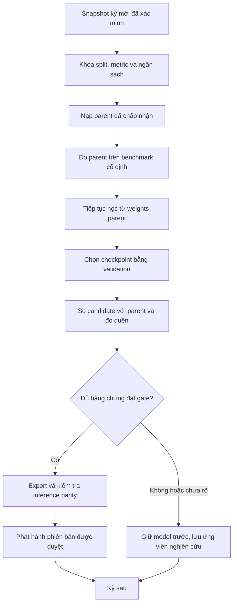

# Đánh giá tính thực tế và thiết kế lại Continual RL theo học kỳ cho UniMatch

**Hướng đã chọn sau thảo luận:** bổ sung các vòng RL có phản hồi thật trong từng kỳ; vòng ngoài vẫn kế thừa qua kỳ. [Đặc tả hai cấp hiện hành](rl_hai_cap_va_corpus_giang_vien_20261027.md) có ưu tiên hơn phần đề xuất một vòng cập nhật/kỳ bên dưới. Các phát hiện code/gate vẫn giữ là bằng chứng khảo sát, chưa phải triển khai hai cấp.

Ngày đối chiếu: **27/10/2026**. Phạm vi: đọc source, các gate/report đã lưu và nguồn học thuật; thiết kế lại quy trình. Chưa sửa code, chạy training, chạy test hoặc thay model đang phục vụ. Trạng thái runtime/cloud không được kiểm tra trực tiếp trong lần này.

## 1. Kết luận

**Khả thi về kỹ thuật và phù hợp mục tiêu khóa luận, nhưng repository chưa có chuỗi học kỳ thực tế hoàn chỉnh đã được kiểm chứng.**

Cần phân biệt bốn trạng thái:

1. PPO và DQN đang có khả năng học, lưu và nạp trọng số.
2. Có thí nghiệm tiếp tục thêm bước trên cùng bộ dữ liệu.
3. Có bộ khung Phase 6 diễn tập cập nhật kỳ, replay, snapshot và rollback.
4. Chưa có bằng chứng đã nối các kỳ độc lập theo thời gian, rồi phát hành ứng viên tốt hơn cho kỳ tiếp theo.

Nhận định trước đây rằng đường GitHub retraining khởi tạo model mới là đúng cho đường đó, nhưng chưa bao quát toàn repository: **Phase 6 đã có `continue_ppo` và `ContinualDQN`**. Thiết kế phù hợp là hoàn thiện và nối các thành phần này, không xây lại RL từ đầu.

Continual RL là bài toán học và duy trì năng lực trong chuỗi môi trường thay đổi, không phải một thuật toán thay thế PPO/DQN. PPO và DQN vẫn là learner; snapshot theo kỳ, kế thừa, rehearsal, đánh giá và quản lý phiên bản tạo thành quy trình continual. [Tổng quan continual RL](https://arxiv.org/abs/2012.13490).

## 2. Có giống cách các hệ thống RL vận hành không?

### 2.1. Những điểm phù hợp

- Model được huấn luyện từ tương tác với environment, lưu checkpoint, rồi tiếp tục từ tham số đã học.
- Khi bài toán thay đổi, phải kiểm tra input/action/reward có còn tương thích.
- Tách quá trình học khỏi xử lý yêu cầu người dùng là lựa chọn hợp lý cho hệ thống phân công theo đợt.
- Phải đánh giá ứng viên và giữ khả năng quay về model trước; không đưa mọi checkpoint vừa train vào vận hành.

Lưu/nạp trạng thái phục vụ học tiếp là khả năng được tài liệu SB3 hỗ trợ. Tuy nhiên, một checkpoint tùy biến chỉ có những trạng thái mà code thực sự lưu. [SB3 saving/loading](https://stable-baselines3.readthedocs.io/en/master/guide/save_format.html).

### 2.2. Những điều không nên đồng nhất

Không có một lịch vận hành chung cho mọi hệ thống RL. Self-play, robot, contextual bandit và phân công giảng viên có tần suất tương tác, feedback và mức rủi ro khác nhau.

UniMatch có quyết định học vụ ít, outcome có thể đến cuối kỳ, quota làm các lựa chọn phụ thuộc nhau. Vì vậy, **cập nhật theo đợt ở ranh giới học kỳ** thực tế hơn việc mỗi form vừa gửi đều làm model đổi trọng số.

Nghiên cứu về RL thực tế nhấn mạnh các khó khăn như dữ liệu hạn chế, chậm phản hồi, ràng buộc và môi trường không dừng. Nó không bảo đảm rằng đưa RL vào một bài toán cụ thể sẽ tốt hơn phương pháp tối ưu truyền thống. [Challenges of Real-World RL](https://research.google/pubs/challenges-of-real-world-reinforcement-learningdefinitions-benchmarks-analysis/).

### 2.3. Đối với model hiện có của UniMatch

Source serving hiện nạp checkpoint đã chọn để inference. Endpoint không tự cập nhật weights khi nhận CSV/form. Đây là cơ chế phục vụ hợp lý, nhưng **inference từ model RL không chứng minh hệ thống đã vận hành continual learning**.

Các report/gate local vẫn ghi model ở phạm vi nghiên cứu và chưa có promotion học kỳ thật. Không dùng nhận định này để suy đoán trạng thái dịch vụ remote hiện tại; cần một lần kiểm tra runtime riêng nếu muốn kết luận về model đang thực sự được nạp trên server.

## 3. Đã có gì, còn thiếu gì trong source hiện tại?

| Hạng mục | Bằng chứng đọc trực tiếp | Đánh giá |
|---|---|---|
| Học tiếp trong một run | `src/evaluation/github_retraining.py` cập nhật agent qua các milestone | Có; mỗi job ban đầu vẫn tạo model mới |
| Nạp parent rồi thêm bước | `src/evaluation/rl_convergence.py` | Có; dữ liệu vẫn là cùng suite phi thời gian |
| PPO chuyển môi trường | `src/rl/semester_learning.py::continue_ppo` | Có: copy policy/optimizer/counter và tạo rollout mới |
| DQN lưu giữ kinh nghiệm cũ | `src/rl/continual_dqn.py` | Có: old/current buffers, batch 50/50 |
| Kiểm tra tương thích | `validate_continual_contracts` | Có: kiểm tra semantics và bridge cho thay đổi dataset |
| Snapshot theo kỳ | `src/data_pipeline/semester_snapshots.py` | Có kiểm tra metadata/hash/provenance; không tự chứng thực nội dung học vụ |
| Chia thời gian | `temporal_split` | Có helper cho ít nhất ba kỳ đã chốt; không phải toàn bộ controller của các vòng |
| Đo quên | `forgetting_report` | Có so parent/candidate trên cohort đóng băng; chưa phải ma trận xuyên mọi vòng |
| Offline job | `OfflineJobs` | Có queue/claim/result; chưa phải worker học kỳ hoàn chỉnh |
| Registry/rollback | `src/serving/rebuild_registry.py` | Có sandbox và technical drill; chưa chứng minh promotion học vụ thật |
| Kết quả Phase 6 | `data_rebuild/v1/reports/phase6_gate.json` | `partial`, `research_rehearsal_only`; temporal forgetting và unseen-semester performance là `null` |
| Dữ liệu gold kiểm tra lại | `students.csv`: 194 hàng, cùng `pilot-next-term`, `cohort_year` đều trống | Chưa đủ để gán các vòng lịch sử theo năm |

Các số test và kết quả diễn tập trong báo cáo Phase 6 là bằng chứng đã lưu của lần chạy trước. Lần nghiên cứu này không chạy lại để xác nhận chúng vẫn pass trên mọi trạng thái source hiện tại.

## 4. Các vòng chưa rõ ở chính xác những chỗ nào?

### 4.1. “Milestone” đang dễ bị gọi nhầm là “vòng”

Các mốc 16.384, 24.576 hoặc 32.768 bước có thể là các checkpoint của cùng một vòng, không phải các học kỳ khác nhau. Chưa đổi dataset và cutoff thì chưa có bằng chứng mô hình thích nghi kỳ mới.

Quy ước mới:

- **Step:** phân một sinh viên trong environment.
- **Episode:** hoàn tất một cohort phân công.
- **Checkpoint:** ảnh chụp model sau một số bước.
- **Vòng cập nhật:** nhận một snapshot kỳ mới đủ điều kiện, kế thừa parent, học, đánh giá và chốt quyết định.
- **Release:** model đã được chọn để phục vụ; có thể giữ nguyên qua nhiều kỳ.

### 4.2. Chưa có đầu vào thời gian sạch cho từng vòng

Label `pilot-next-term` không thay cho năm/học kỳ thật. Ngày crawl và năm tuyển sinh không thay cho ngày thông tin đã có tại thời điểm chọn giảng viên.

Model hiện học từ bộ trộn kỳ không thể dùng để kiểm tra ngược 2024 rồi tuyên bố đã dự đoán tương lai năm đó. Muốn có backtest lịch sử sạch cần khởi tạo một baseline theo cutoff lịch sử; sau lần khởi tạo đó, các vòng chính mới kế thừa liên tục. Đây là thiết lập thí nghiệm ban đầu, không phải reset model mỗi năm.

### 4.3. Chưa có worker điều phối đầy đủ một vòng thật

`scripts/rehearse_semester_learning.py` phục vụ rehearsal. Nó chưa là entrypoint nhận snapshot kỳ mới, parent đã chấp nhận, danh sách benchmark lịch sử và chính sách phát hành rồi hoàn tất một vòng học kỳ.

Đặc biệt, gate rehearsal trong source chủ động trả `partial`. Không thể làm vòng thật hoàn chỉnh bằng cách chỉ đổi nhãn gate thành pass.

### 4.4. DQN chưa có đường chuyển sang kỳ thứ ba hoàn chỉnh

Đây là khoảng trống nhìn thấy bằng đọc source, chưa chạy tái hiện lỗi:

- `ContinualDQN.from_checkpoint` gọi `MaskedDQN.load` cho parent native.
- `ContinualDQN.save` lưu bundle ở dạng `old/`, `candidate/`, `continual.json` và checksum riêng.
- `ContinualDQN.load` có thể khôi phục bundle đó để học tiếp **cùng vòng**.
- Chưa có thao tác rõ ràng để chốt vòng hiện tại, gộp/chọn bộ nhớ của mọi kỳ cũ và bắt đầu vòng mới từ bundle continual.

Nếu trỏ thẳng bundle continual vào loader native thì định dạng không khớp. Nếu chỉ lấy `candidate/` làm parent native của kỳ sau, weights mới được giữ nhưng replay trực tiếp của các kỳ xa hơn không được mang theo đầy đủ, vì thư mục đó chỉ lưu current replay. Trọng số vẫn có thể giữ kiến thức cũ; vấn đề là rehearsal history chưa được định nghĩa xuyên nhiều kỳ.

### 4.5. Bộ nhớ cũ–mới mới rõ cho một lần chuyển

Tỷ lệ 50/50 hiện hữu không tự trả lời: khi đã có 2023, 2024 và 2025 thì “old” gồm những gì, dung lượng bao nhiêu, lấy mẫu theo năm hay theo transition? Những kỳ nhiều rollout có lấn át kỳ ít sinh viên không?

Không được biến một triệu transition từ cùng 30 form thành một triệu mẫu sinh viên độc lập.

### 4.6. Artifact nghiên cứu và artifact phục vụ chưa được nối thống nhất

`src/serving/rebuild_service.py`, `src/serving/github_service.py` và release loader nạp model bằng loader native. Registry cũng yêu cầu metadata/checksum native tại đường dẫn được đăng ký. Bundle continual DQN không thể mặc định thay trực tiếp vào các vị trí này.

Cần một export rõ nghĩa: giữ full training bundle để tiếp tục học, đồng thời xuất inference checkpoint phù hợp serving. Hai artifact phải gắn cùng version và kiểm tra output parity.

### 4.7. Chưa có thước đo xác nhận cải tiến liên kỳ

Phase 6 mới có regression trên validation dùng lại. Chưa có bảng so parent/candidate trên cùng kỳ mới và benchmark kỳ cũ thực tế. Hàm đo quên hiện so trước–sau; nếu muốn đo quên so với mức tốt nhất từng đạt, cần giữ lịch sử các lần đo.

“Có bước cập nhật weights” và “validation một lần tăng” chưa đủ để chốt model sau tốt hơn model trước ở kỳ tiếp theo.

## 5. Thiết kế lại phù hợp: học theo đợt ở mỗi học kỳ

### 5.1. Chọn đơn vị học kỳ, không ép theo năm

Tên vòng sử dụng mã kỳ được xác minh, ví dụ `2024.1`. Có thể tổng hợp theo năm để viết luận văn, nhưng không gộp kỳ có điều kiện phân công khác nhau thành một phiên bản mơ hồ.

Với kỳ quá ít mẫu, có thể gom nhiều đợt đã đủ điều kiện thành một lần cập nhật. Vẫn lưu snapshot từng kỳ và ghi rõ kỳ nào không cập nhật. Không tạo một version model giả chỉ để đủ bảng theo năm.

### 5.2. Hai chu kỳ riêng biệt

**Chu kỳ phân công:** model đóng băng nhận hồ sơ đầu kỳ, tạo đề xuất, lưu version và dữ liệu đầu vào. Không học ngay trong request.

**Chu kỳ cập nhật:** worker offline dùng snapshot đã được duyệt tại cutoff, nạp parent, học ứng viên, đánh giá, rồi quyết định có phát hành không.

Hai loại feedback có thời điểm khác nhau:

- Utility tương đồng đã tính được từ hồ sơ đầu kỳ: có thể dùng ngay trong environment phân công mô phỏng.
- Điểm/tiến độ/phản hồi học vụ: chỉ dùng sau khi thực sự xuất hiện và được xác minh.

Do đó thiếu điểm cuối kỳ không cản mọi nghiên cứu continual RL; nó cản việc khẳng định đang học/cải thiện outcome thật. Phiên bản đầu nên giữ reward hiện tại để cô lập ảnh hưởng của học tiếp tục. Không thêm IRL vào cùng thí nghiệm này.

### 5.3. Lịch vòng minh họa

Giả sử dữ liệu trước 2023 tồn tại và đã được xác minh. Đây là lịch đề xuất, không phải mô tả dữ liệu đang có.

| Thời điểm | Model dùng để dự đoán | Dữ liệu dùng cập nhật sau đó | Kết quả có thể tạo |
|---|---|---|---|
| Bootstrap | Chưa có | Train và validation nội bộ đều trước cutoff 2023 | `V_base` |
| Kỳ 2023, nếu có | `V_base` | Phần train của 2023 sau cutoff hợp lệ | Ứng viên `V2023` |
| Kỳ 2024 | Phiên bản đã chấp nhận gần nhất | Phần train của 2024, thêm rehearsal lịch sử | Ứng viên `V2024` |
| Kỳ 2025 | Phiên bản đã chấp nhận gần nhất | Phần train của 2025, thêm rehearsal lịch sử | Ứng viên `V2025` |
| Kỳ 2026 | Phiên bản đã chấp nhận đến hết 2025 | Chỉ cập nhật sau khi kết thúc phép đánh giá đã khóa | Kết quả kiểm tra 2026 |

Nếu không có dữ liệu 2023 thì ghi khoảng trống; V2024 có thể kế thừa V_base. Nếu V2024 bị từ chối thì vòng 2025 kế thừa bản được chấp nhận gần nhất, không giả vờ V2024 đã tốt hơn. Chỉ khi mọi ứng viên đều đạt gate mới có đúng chuỗi `V_base → V2024 → V2025` như mong muốn.

### 5.4. Tách đánh giá trước cập nhật với chọn ứng viên

Một vòng k gồm hai câu hỏi riêng:

1. Parent đã hoạt động thế nào trên kỳ k trước khi nhìn thấy dữ liệu kỳ này?
2. Sau cập nhật, candidate có tốt hơn parent trên benchmark được giữ ngoài learner không?

Đề xuất giao thức:

- Đóng băng snapshot và quy tắc chia trước khi train. Group theo sinh viên/đề tài/tài liệu trùng, không chia ngẫu nhiên theo transition.
- `D_k_train`: chỉ phần này được vào learner.
- `D_k_val`: dùng chọn checkpoint và quyết định ứng viên; parent và candidate được chấm trên đúng cùng tập này.
- `E_old`: các benchmark lịch sử không vào learner, dùng đo quên và an toàn.
- Kỳ kế tiếp hoặc một final holdout riêng: dùng kiểm tra tổng quát hóa; không dùng để chọn checkpoint hiện tại.

Điểm parent đo trước cập nhật trên một tập rồi tập đó được dùng học sau này vẫn là phép đo quá khứ hợp lệ, nhưng không phải final test của candidate đã học nó. Nếu benchmark cũ được dùng trong nhiều quyết định phát hành, gọi nó là regression/validation bank; không gọi “test chưa từng dùng”.

Nếu kỳ có quá ít mẫu để giữ validation có ý nghĩa, chọn một trong hai chế độ đã công bố trước: (a) chưa cập nhật và chờ thêm dữ liệu; (b) chạy ứng viên nghiên cứu với hyperparameter đã khóa từ quá khứ, nhưng chưa tuyên bố đủ bằng chứng cải tiến/phát hành. Không đặt một ngưỡng số form chung tùy tiện.

Đánh giá theo cohort có quota phải giữ nguyên tập sinh viên, tải ban đầu, capacity và policy khi so parent/candidate. Nếu chia cohort để tạo train/validation, phải công bố quota của từng bài toán con, dùng cùng quota cho mọi model và chỉ diễn giải kết quả trong bài toán con đó. Không so điểm từ hai bài toán khác nhau rồi gọi là cải thiện.

## 6. Các bước rõ ràng của một vòng

| Bước | Đầu vào | Đầu ra | Điều kiện đi tiếp |
|---|---|---|---|
| 1. Chốt nguồn | Hồ sơ kỳ, thời điểm thông tin có sẵn, provenance | Snapshot bất biến | Xác minh kỳ và thông tin trước phân công |
| 2. Khóa giao thức | Snapshot, metric, ngân sách, split | Round manifest | Không giao sinh viên/source giữa train và holdout |
| 3. Chọn parent | Model đã chấp nhận gần nhất, cùng thuật toán/seed | Parent hash và lineage | Checksum và semantics khớp |
| 4. Đo parent | Validation mới và regression bank cũ | Baseline report | Cohort/score/constraint đã đóng băng |
| 5. Khởi tạo candidate | Parent + dataset mới | Weights khởi đầu giống parent | Không random lại policy/Q-network |
| 6. Học | Train mới + rehearsal cho phép | Checkpoint/logs | Holdout không vào learner |
| 7. Chọn checkpoint | Validation theo lịch định trước | Candidate đã chọn | Không chọn bằng final test |
| 8. Đánh giá và chốt | Candidate + parent + baselines | Accept/reject/inconclusive | Đủ safety, chất lượng và mức quên |
| 9. Export | Candidate được chấp nhận | Training bundle + inference bundle | Reload/output parity |
| 10. Phát hành | Bundle + báo cáo + phê duyệt phù hợp | Active version hoặc giữ bản trước | Không sửa lịch sử phân công |

Các bước trên là lifecycle đề xuất; không cần tạo mười service hoặc mười module. Tận dụng snapshot/queue/registry hiện có và một worker điều phối tối giản.



## 7. Learner trong mỗi vòng

### 7.1. PPO

Tái sử dụng `continue_ppo`: copy actor/critic, optimizer và bộ đếm từ parent. Dùng rollout mới, không tái dùng trajectory PPO cũ như transition DQN. PPO luân phiên thu tương tác và cập nhật policy, nên rehearsal ở đây là chọn lại một số environment lịch sử rồi thu rollout mới bằng policy hiện tại. [PPO gốc](https://arxiv.org/abs/1707.06347).

Preprocessing, action order và reward phải tương thích. Các RNG/scheduler chưa lưu đầy đủ trong checkpoint hiện tại phải được ghi thành giới hạn: đây là tiếp tục huấn luyện với rollout khởi động lại ở ranh giới kỳ, không chứng minh tương đương bit-for-bit với run không gián đoạn. Điều này vẫn đáp ứng yêu cầu không train lại từ đầu.

Mỗi vòng có thể reset environment ở đầu episode; không cần giữ một episode dang dở từ kỳ trước. Learning-rate/exploration schedule và mọi reset có chủ đích phải được lưu trong manifest.

### 7.2. DQN

Giữ online network, target network, optimizer và các counter cần thiết. Thiết kế bộ nhớ tối giản:

- `history_memory`: bộ nhớ có giới hạn dung lượng, đại diện cho tất cả các kỳ train đã được chấp nhận.
- `current_memory`: transition train của vòng hiện tại.
- Sampling cũ/mới: bắt đầu bằng chính sách 50/50 hiện có, xem đây là baseline nghiên cứu; không khẳng định tỷ lệ tối ưu.
- Bên trong history, giữ provenance và tránh để kỳ tạo nhiều rollout chi phối hoàn toàn mẫu.
- Khi chốt vòng, cập nhật history theo chính sách cố định đã khai báo, rồi tạo full bundle làm parent vòng sau.

Cần thao tác chuyển vòng rõ nghĩa, ví dụ trách nhiệm `start_next_round`, chấp nhận native bootstrap hoặc full continual bundle. Đây là tên trách nhiệm thiết kế, chưa yêu cầu tạo một abstraction/framework mới.

Không chỉ lấy replay của kỳ gần nhất và gọi đó là toàn bộ lịch sử. Khi memory không đủ giữ mọi transition, ghi rõ tiêu chí giữ/lấy mẫu; giữ thông tin nguồn/kỳ của từng transition mới. Replay lịch sử cũ chỉ có provenance cấp cohort thì giữ nguyên giới hạn đó, không tự bịa student ID.

### 7.3. Roster, quota và encoder

- Số lượng capacity có thể đổi theo kỳ nếu state/mask đã biểu diễn và replay giữ đúng bối cảnh của nó; đổi rule/nghĩa quota cần kiểm tra tương thích riêng.
- Giảng viên có thể inactive và bị mask, nhưng đổi số action hoặc thứ tự ID không thể coi là thay dataset thông thường.
- Đóng băng encoder/taxonomy cho chuỗi thí nghiệm đầu; chỉ dữ liệu đầu vào thay theo kỳ.
- Không bổ sung chuyên môn của giảng viên bằng khóa luận chưa xuất hiện ở cutoff lịch sử.
- Nếu bắt buộc mở rộng action/schema, tạo một thí nghiệm migration có mapping và kiểm chứng riêng. Không bỏ guard để ép checkpoint cũ chạy.

Registry giảng viên cố định là giới hạn chấp nhận được cho phạm vi luận văn đầu tiên, nhưng phải công bố phạm vi đó. Không hứa model hiện có tự hỗ trợ cold-start mọi giảng viên mới.

## 8. Phiên bản, checkpoint và điều kiện cải tiến

### 8.1. Hai lineage riêng cho PPO và DQN

```text
PPO/base/seed42 -> PPO/2024.1/seed42 -> PPO/2025.1/seed42
DQN/base/seed42 -> DQN/2024.1/seed42 -> DQN/2025.1/seed42
```

Không chuyển weights PPO thành DQN. Các seed khác có chuỗi parent riêng. Dùng nhiều seed để đo độ ổn định, không xem các seed là các học kỳ độc lập.

Manifest tối thiểu của mỗi vòng:

```text
round_id, semester_id, algorithm, seed
parent_model_id, parent_training_bundle_sha256
data_cutoff, snapshot_sha256, split_sha256
representation_sha256, reward_version, registry_sha256
steps_before, steps_added, steps_after
memory_policy, optimizer_policy, exploration_policy
checkpoint_selection_rule, evaluation_report_sha256
decision, active_release_id
```

Hai artifact cùng version:

- **Training bundle:** weights, optimizer, target nếu có, counters, memory, lineage và contract; để học tiếp.
- **Inference bundle:** cấu trúc native phù hợp loader hiện có, encoder/catalog/contract tương ứng; để phục vụ.

Không cần nhét replay và optimizer vào request inference. Không bỏ full training bundle chỉ vì inference đã chạy được.

### 8.2. Gate chấp nhận

Thiết lập trước khi xem kết quả:

1. Không vi phạm constraint cứng trong các ca đánh giá; coverage đáp ứng cấu hình và không che ca thiếu dữ liệu.
2. Candidate không giảm chất lượng kỳ mới vượt tolerance; muốn gọi là **cải tiến** phải đạt mức tăng có ý nghĩa thực tế đã khai báo.
3. Suy giảm trên regression bank kỳ cũ không vượt giới hạn.
4. Chi phí cập nhật nằm trong ngân sách; reload/export đúng.
5. Có đủ bằng chứng; nếu bất định quá lớn thì kết luận **chưa rõ**, không ép thành pass.

Tách hai loại quyết định: một candidate có thể được xem là không kém để phục vụ mục tiêu thích nghi, nhưng chưa đủ chứng cứ gọi là cải tiến. Nếu yêu cầu luận văn là mỗi phiên bản công bố phải tốt hơn, chỉ gắn nhãn phiên bản cải tiến khi vượt gate cải tiến; các lần học còn lại giữ trạng thái candidate.

Checkpoint tốt nhất trong ngân sách không phải chứng minh hội tụ. Đường cong phẳng là plateau thực nghiệm nếu đạt tiêu chí đã khai báo; không bảo đảm train tiếp sẽ không tăng hoặc giảm.

### 8.3. Nếu một vòng không đạt

Giữ active model và parent được chấp nhận gần nhất. Lưu candidate, lý do reject/inconclusive và snapshot để nghiên cứu. Không làm mất dữ liệu kỳ bị từ chối: kỳ sau có thể dùng các mẫu train đủ điều kiện của các kỳ tồn đọng, nhưng phải khai báo chúng trong manifest và tiếp tục giữ nguyên benchmark holdout.

Không tăng phiên bản “đã cải tiến” chỉ vì đã đến năm mới. Không bắt đầu từ ứng viên thất bại rồi mô tả như chuỗi đã được nghiệm thu. Có thể nghiên cứu thêm một chuỗi thích nghi không qua gate, nhưng phải tách rõ khỏi chuỗi vận hành; không cần triển khai nhánh này trong thiết kế tối giản.

## 9. Các phép kiểm chứng cần có trước khi gọi là hoàn chỉnh

| Phép kiểm chứng đề xuất | Nó chứng minh gì? |
|---|---|
| Bootstrap, rồi hai vòng dataset mới khác nhau | Hệ thống thực sự đi qua ít nhất ba trạng thái model, không chỉ resume cùng vòng |
| Weights lúc bắt đầu candidate giống parent | Không train lại từ đầu |
| Sau cập nhật weights thay đổi và log hữu hạn | Có learning thực sự; chưa chứng minh chất lượng |
| DQN qua vòng thứ ba vẫn lấy mẫu được nguồn lịch sử đã khai báo | Rehearsal history không bị rơi mất khi chuyển kỳ |
| Holdout và nguồn alias không vào learner/memory/fit encoder | Chống leakage |
| Parent/candidate được chấm trên cùng cohort | Chênh lệch điểm có thể so sánh |
| Ma trận hiệu năng model × benchmark kỳ | Đo thích nghi và quên qua nhiều vòng |
| Training/inference bundle cho kết quả khớp | Artifact phát hành đúng model đã đánh giá |
| Candidate bị từ chối không đổi active version | Gate có hiệu lực |
| Rollback giữ lịch sử phân công | Đổi model không viết lại quyết định cũ |

Đây là danh sách kiểm chứng cho lần triển khai sau; chưa được chạy trong lần nghiên cứu này. Tests fixture thành công chỉ xác nhận cơ chế; dữ liệu học kỳ thật và khả năng tổng quát hóa phải có đánh giá riêng.

Nếu reward vẫn là tổng utility cộng theo cặp với quota, giữ Hungarian làm mốc tối ưu cùng objective. Không kỳ vọng RL vượt nghiệm tối ưu chính xác của cùng bài toán. Giá trị nghiên cứu của continual RL có thể nằm ở thích nghi, độ trễ/chi phí khi suy luận hoặc mục tiêu tuần tự phù hợp, nhưng từng lợi ích phải được đo.

## 10. Thay đổi tối thiểu khi được triển khai sau này

1. **Dữ liệu trước:** xác minh kỳ/cutoff, tạo snapshot và benchmark. Chưa có nguồn thì dừng ở diễn tập có nhãn rõ.
2. **Giữ learner:** tái dùng PPO/DQN đang có; chưa thêm thuật toán hay dependency.
3. **Hoàn thiện vòng DQN:** hỗ trợ bắt đầu kỳ tiếp theo từ full bundle, history memory có dung lượng và provenance rõ.
4. **Một worker học kỳ:** nối snapshot, parent, learner, evaluation và quyết định bằng round manifest; tách khỏi CLI rehearsal.
5. **Nối artifact:** export native inference bundle từ candidate đã đánh giá; liên kết với training bundle và registry.
6. **Đo chuỗi:** thực hiện bootstrap và ít nhất hai vòng cập nhật, kèm baseline/forgetting/bất định.

Không cần sửa frontend cho nghiên cứu lõi. Chưa cần model registry bên ngoài, message broker, feature store hoặc hệ orchestration mới. Dùng file manifest và queue/registry sẵn có là đủ cho quy mô hiện tại.

## 11. Tài liệu tham chiếu và giới hạn

- [Khetarpal et al., Towards Continual Reinforcement Learning](https://arxiv.org/abs/2012.13490): định nghĩa, lưu giữ kiến thức và đánh giá continual RL.
- [Schulman et al., PPO](https://arxiv.org/abs/1707.06347): cơ chế thu tương tác và cập nhật policy.
- [SB3, On saving and loading](https://stable-baselines3.readthedocs.io/en/master/guide/save_format.html): tham số và trạng thái checkpoint.
- [Dulac-Arnold et al., Challenges of Real-World RL](https://research.google/pubs/challenges-of-real-world-reinforcement-learningdefinitions-benchmarks-analysis/): giới hạn khi đưa RL vào bài toán thực tế.
- Nội bộ: [Báo cáo Phase 6](rebuild_phase6_quality_report.md), [Hướng dẫn Phase 6](rebuild_phase6_operator_guide.md), [nghiên cứu hai phương pháp](nghien_cuu_hoc_tiep_tuc_va_hoc_tu_ket_qua_khoa_luan_20261027.md).

Kết luận về cấu trúc source và nội dung gate được kiểm tra trong phiên này. Kết luận về chất lượng học kỳ mới chưa có dữ liệu để đo. Thiết kế trên là đề xuất cho UniMatch, không phải mô tả một chuẩn duy nhất mà mọi hệ thống RL đang sử dụng.
